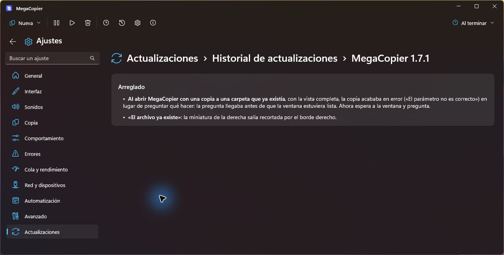
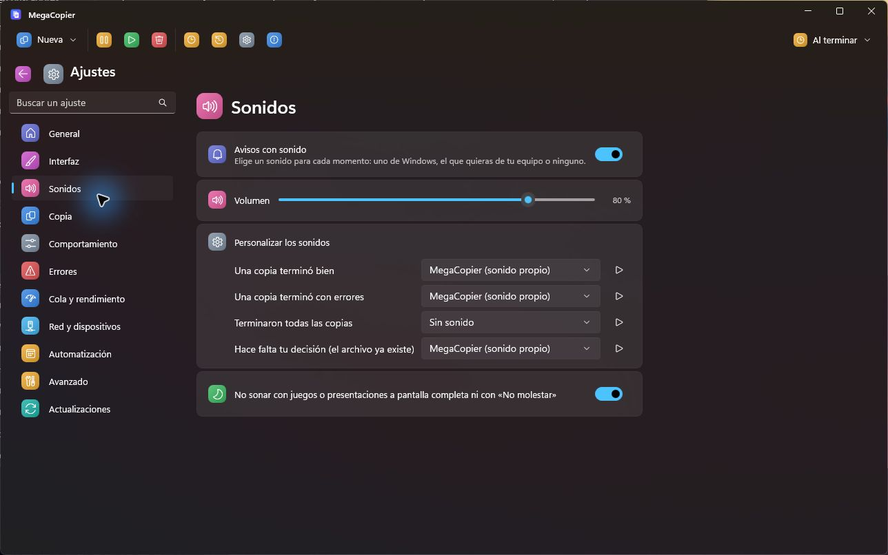

# Changelog

[Español](CHANGELOG.md) · **English**

All notable changes to MegaCopier. The format follows [Keep a Changelog](https://keepachangelog.com/en/1.1.0/)
and versions follow [SemVer](https://semver.org/).

## [Unreleased]

### Highlights

- Check, download and install updates from Settings without interrupting transfers. One fixed-size button follows each step, with progress, Windows notifications and status badges styled for the selected icon pack.
- Choose how much to automate: checking every two days, downloading automatically discovered versions, or installing while MegaCopier is in the tray with no pending work. Only checking is on by default; downloads respect your Wi-Fi, Ethernet and metered-network permissions.
- Read the available version’s main improvements and open the full notes with images inside the app. History includes previous versions, using Spanish for the Spanish interface and English for every other interface language.
- Optional error reports help improve MegaCopier without attaching files, names or paths. Choose during installation or in Settings whether to send in the background or review each report first.
- The installer lists optional shortcuts before integration choices, introduces MegaCopier artwork and displays the privacy policy before installing. Automatic checking and error reporting can both be deselected.
- Settings uses smooth navigation transitions and the toolbar button returns to transfers. Mouse side buttons also navigate back and forward; Sounds separates alerts, volume, customization and quiet mode for games or presentations.
- Fixes cover startup crashes during network detection, stray Back tooltips, and clipped or misaligned headings and badges. Updates verify the signed manifest and package checksum before installation.

### Added

- **Update center:** check, download, cancel, verify and install with one fixed-size action on the right and a shared progress bar. Portable copies offer a ZIP only when a newer version exists.
- **Independent automation:** check every 48 hours and catch up after Internet access returns when overdue. Only versions discovered by automatic checks qualify for automatic download; manual checks offer Download. Download and installation are off by default. Automatic installation waits until the app is in the tray without active, pending or paused transfers, dialogs or live synchronization.
- **Network permissions:** unmetered Wi-Fi and Ethernet by default; mobile and metered connections require permission. Changes also apply to a running download. The interface does not display the current connection type.
- **Native Windows notifications:** an available version, a verified download ready to install, and a completed update. Notifications open Updates; opening that section clears the pending completed-update badge.
- **Highlights and complete history:** a summary of the installed or available version, full notes with links and images, and an Updates > Update history > MegaCopier and version breadcrumb. Images align left and cached notes remain available offline. Previous releases now also have complete English notes.

- **Optional private reports:** a choice in the installer and Settings > Advanced, exact report preview, local logs, and background sending without a prompt when authorized. When disabled, the dialog offers one-time sending or permission for future reports. Detects unexpected exits and available native crash events for that session; a power outage can also leave an unexpected-exit marker.
- **Configured Cloudflare and private GitHub receiver:** filtered traces without free-form messages, names or paths, a consented queue, limited retries and grouping of repeated failures. Disabling reporting removes local queued reports, not reports already received. The privacy policy explains providers and retention limits.

- **Reorganized installer:** desktop and Start menu shortcuts, plus preparing a shortcut for the user to pin through Windows, are all off by default. Integration groups Explorer, Windows startup, automatic checks and error reports last. Reporting is selected with its explanation underneath; silent updates preserve the preference. Includes original sidebar artwork and a privacy policy before installation.

### Changed

- **Four sound cards:** alerts with a bell; an inline volume icon, label, slider and percentage; per-event customization; and a quiet-mode toggle for games, presentations or Do Not Disturb, on by default for new settings. Existing preferences are preserved.

- **Bilingual documentation:** visible links to the project overview and complete changelog in English and Spanish. Future release pages show both languages, starting with highlights; separate note assets retain the full document for the app. Editorial guidance allows properly developed summaries of the necessary length and groups minor fixes without inventing counts.
- **Reviewed translations:** all 14 languages share the same keys and formatting parameters. The fast-device path example comes from translated resources; filters in languages other than Spanish and English use a supported extension-and-size example instead of an untranslated English sentence.

### Fixed

- **Startup:** querying the updater’s network connection outside the UI thread avoids a WinUI crash when launching the EXE.
- **Offline behavior:** preserve the last known result and cached notes. A network warning appears after a manual check or download and clears when leaving the section. Reconnecting allows a retry; connection changes do not trigger version checks before the 48-hour interval expires.
- **Returning to Updates:** offer Check for updates again when no newer version is known. The button shows You’re up to date after a manual check finds no update; an available version keeps its Download or Install action and highlights.
- **Navigation:** the sidebar selection and page content slide from the first change, including rapid selections. Back and forward reverse the transition; Alt+Left/Right and mouse side buttons also work. The toolbar Settings button returns to transfers or home and restores the previous window size.
- **Tooltips:** Back no longer appears when hovering outside the actual Back button, including when the window is unfocused.
- **Alignment:** headings and history breadcrumbs stay level with the search box, leave room for descenders and optically align separators. Each history card centers its action text and arrow together on the right.
- **Badges:** the Settings-button notification is no longer clipped with custom icon packs and the sidebar badge aligns right. Arrows rotate during checks and downloads; icon packs retain their style for the green check, yellow attention mark and red X when automatic checks are disabled or a connection action fails.
- **Installation and preferences:** the reports checkbox and explanation remain visible without clipping; Settings places the toggle first and log shortcuts horizontally. Network choices also share a row with spacing.

### Security

- **Verified updates:** ECDSA P-256 manifest and SHA-256 for installer and ZIP; packages never execute without a trusted key and valid signature. The production public key is embedded in the app; the private key stays outside the repository and in a GitHub Actions secret.
- **Windows signing pending:** application submitted to SignPath Foundation on October 21, 2026, with receipt confirmed. Approval and Authenticode certificate access remain pending; this setup does not sign current executables or guarantee removal of SmartScreen warnings.

## [1.7.1] - 2026-10-20

### Fixed

- **Opening MegaCopier with a transfer to an existing folder** in the expanded view could fail with “The parameter is incorrect” instead of asking what to do: the question arrived before the window was ready. It now waits for the window before asking.
- **“File already exists”**: the thumbnail on the right was clipped at its right edge.

## [1.7.0] - 2026-10-20

### Added

- **The window no longer loses its material when another window is active**: the default background in Fluent themes uses Mica and switches to Mica Alt while you use another window, instead of becoming a solid color. It returns to Mica when focused. Other backgrounds selected in Settings behave like Windows backgrounds.
- “Start with Windows” in the tray menu has an icon from the selected icon pack.

### Changed

- **Resuming a large file starts writing immediately**: previously, all previously copied source data was read again to calculate the whole-file checksum. On a USB drive with several GB, this looked like the transfer had restarted, although it had not. The checksum is now calculated only when needed by verification, a checksum file, storing the checksum in the file, or forensic mode, while the remaining data is copied. Without those features, the file list leaves its checksum empty, as it does for cloned files.
- **“File already exists” plays its sound only once per transfer**: “One by one” previously played it for every repeated file.
- **“File already exists” always has the same size**, slightly wider than before; it no longer grows or shrinks with paths, thumbnails, or identical files.
- **Window background** (Settings › Interface): theme background, Mica, Mica Alt, Acrylic, and Translucent (lighter, more transparent acrylic). The duplicate option was removed: the old Translucent was the same acrylic.
- **Acrylic menus, option lists, and dialogs**, with any theme and window background: menus (New, When finished, “…”, right-click) remain acrylic without focus; all dropdowns in Settings, dialogs, and the file filter blur what is behind them, like menus. Dialogs such as folder and file conflicts blur the window they cover instead of showing solid gray with a differently colored button area. With Windows transparency disabled or acrylic unavailable, they use a solid theme color.
- The tray menu is acrylic like other menus, regardless of the window background. About and the drop shelf also use acrylic.
- **Opening Settings from the compact window** now animates its growth, like shrinking, without a black rectangle. This also applies when a second transfer automatically opens the expanded view. “More” grows without an initial jump.
- **The file-list view (“More”) opens at a practical default size** (760 × 660); you can enlarge it. The transfer-list view is unchanged.
- **Switching transfers in the compact window** slides the card in the direction of the selected button.
- **The destination drive is aligned to the right** of its row, with the source on the left. This gives the transferred item's name more space; a long destination extends toward the middle.
- **Numbers no longer shift around**: file counts, sizes, speed, and remaining time keep their positions, align right, and use equal-width digits.
- Pause / Resume uses the same button colors as other buttons.
- **“When pressing X” and “When minimizing” have separate cards**, each with its own help button.
- Language, size units, and tray icon and progress settings moved to Settings › General.

### Fixed

- **Paste from File Explorer's top command bar** uses MegaCopier and the active tab's folder even if a subfolder is selected. It shares the paste-interception setting with Ctrl+V and the context menu.
- **A repeated individual file prompts again**, even with the same size and date. It offers Replace, Keep both, and Skip, without options for other files. Resuming still detects completed files.
- **Dragging between windows while transfers are running** keeps Esc pressed while confirming that Explorer canceled its drag, and continues stimulating Explorer's input loop during the wait.
- **Paste from Explorer's right-click menu** also uses MegaCopier: modern and classic menu commands are recognized, the destination is resolved, and the menu closes before copying. Unrecognized cases retain Explorer's behavior.
- **Fast Explorer drags** could fall through to Windows because drag-start notification had not arrived when the mouse was released. This transition is now checked briefly without turning rectangle selection into a copy. Remote-mouse and accessibility-tool gestures are supported too.
- **Dropping onto drives in the navigation pane** works when Explorer inserts a root such as “Desktop (OneDrive)” before “This PC”.
- **Pastes while the interface is busy**: an accepted request no longer returns to Windows after a five-second wait, preventing both copiers from executing the same operation.
- **Speed and remaining time with a speed limit**: mcopy showed twice the actual speed and half the remaining time.
- **The window returns to its earlier size after hiding the transfer list**: choosing Add to this transfer or leaving only one transfer previously left it enlarged. It now restores its default or user-chosen size unless you resized it while the list was visible. Separate transfer still keeps the list open.
- **“One by one” in the compact window** could show the next file-conflict dialog displaced above and outside the view after Replace or another decision. The window was shrinking and expanding between files.
- **MegaCopier could crash** when pressing New or closing the tray menu, particularly after changing themes, such as Fluent dark to Classic blue after opening New. Changing the accent reloaded Windows control resources and broke already-open menus; the accent is now applied without reloading them. The WinUI crash probe added in 1.3 (`crashstack.log`) was also removed.
- **Fluent light with Windows dark mode** incorrectly used a dark background with low-contrast text; the window is now actually light.
- **Windows high contrast**: custom theme colors no longer cover system colors in buttons, lists, menus, and dialogs.
- Settings navigation and menu icons sometimes retained the previous icon pack until the theme changed.
- **Ctrl+V could open MegaCopier with “No transfers”** while a transfer was running and taskbar progress was visible: the transfer had remained in a window that was closing.
- Asking whether to add files to a running transfer no longer enlarges the compact window; the question fits its current size.
- **Dragging while transfers were running** could fall through to Windows: Windows silently removes mouse and keyboard hooks if a callback takes too long, for example during a large-transfer GC pause. MegaCopier now detects and reinstalls them, records this in `drag.log`, and avoids long pauses.

## [1.6.0] - 2026-10-19

A release to make everything look and work as expected. Each transfer can have its own window; the selected icon pack reaches menus, tabs, and the tray; the tray menu uses WinUI; and the window supports Mica, Mica Alt, and acrylic. One by one and Overwrite now do what their names say, conflict dialogs show photo thumbnails, and Explorer dragging no longer leaves the mouse button stuck.

 

### Added

- **Each transfer in its own window** (Settings › Behavior): each new transfer gets a window and starts without waiting for the others. This is still one application: all windows share the theme, icons, and settings. Each has a tray progress icon and taskbar button. For transfers targeting the same drive, New transfer to the same drive can ask whether to add it to that window's transfer or open a new window, always add it, or always open another window. Disabled by default.
- **Window background** (Settings › Interface): theme background, translucent, Mica, Mica Alt, Desktop Acrylic base or thin, with any theme. This replaces Translucent window; existing users keep their previous appearance. The theme editor also offers thin acrylic.
- **WinUI tray menu**: right-clicking the main MegaCopier icon or a transfer's icon opens a menu with the application's rounded corners, light/dark theme, and icons.
- File-conflict dialogs indicate when the files have equal size and date.

### Changed

- **The Pause icon morphs into Resume**: its two bars join into a triangle and reverse, using the selected pack's color and background. The label changes in place instead of sliding or overlapping.
- **Every icon follows the selected pack**: New, When finished, “…”, and transfer-list context menus; Files, Destination, Options, Status, and Log tabs; file-list filters and checkboxes; the current-file progress ring; and the tray menu.
- **Tray progress icons follow the selected pack's shape, colors, and finish**: rounded, circular, or square; colored background, gloss, bevel, outline, or neon. Paused transfers show the pause symbol instead of a percentage.
- MegaCopier tray icons are marked as visible in Windows so they appear by the clock rather than behind the overflow arrow. The main icon is configured once, then your choice applies; transfer progress icons are always configured. Windows applies this at sign-in, so it takes effect from the next Windows session.
- File conflicts show photo/video thumbnails and the associated application's icon for PDFs, music, and documents, like Explorer.
- **Compact window**: copied files and sizes stay visible when narrowing the window. When finished keeps its label while space allows. A completed transfer's files, size, time, and speed appear next to Open folder so the card does not grow or cover transfer navigation.
- **About MegaCopier is a separate small Mica window**, replacing a cramped dialog inside the compact window.
- The red active-transfer badge sits at the transfer-list button's corner and looks consistent across icon packs.
- Opening and closing the transfer list slides without text flicker.

### Fixed

- **One by one did not ask**, and **Overwrite skipped already-copied files** with equal size and date. Choosing Overwrite in the existing-destination dialog now recopies all of them; One by one asks about each, including identical files. Skip still leaves existing files untouched.
- Per-file prompts were clipped in the compact window; it now grows as necessary.
- **Dragging in Explorer** could do nothing until the next click and then invoke Windows; dropping onto a navigation-pane drive/folder in the same window never invoked MegaCopier. Explorer's drag loop only serves other applications when mouse activity occurs. MegaCopier now keeps it responsive without moving the pointer, treats each drag independently, and lets Explorer handle the drop if a decision approaches two seconds, so the button never remains stuck. Each drag and its duration are recorded in the data folder's `drag.log`.
- Opening Settings from compact view or automatically expanding no longer exposes a black rectangle while the window grows.
- With Add to the running transfer selected, new items went into the other transfer's folder instead of their own.

### Removed

- Translucent window: it is now one of the Window background choices.

## [1.5.0] - 2026-10-19

Copy several things at once without thinking about scheduling: MegaCopier asks whether to add a transfer to an existing transfer on the same drive, and starts transfers to other drives together. Each transfer has a tray progress icon, X really cancels, dragging supports Explorer's navigation pane, difficult settings have examples, icon packs resemble their systems with seven new packs, and the window fits 1366 × 768 screens.

### Added

- **New transfers to the same drive** bring MegaCopier forward and explain Add to this transfer (append to its list, each item in its own folder, after checking space), Separate transfer (wait for the other transfer; Start begins immediately), and Cancel. Transfers to another drive begin concurrently, since each drive runs at its own speed. Both behaviors can be configured in Settings › Behavior.

  

- **Tray progress icons**, one per running transfer, show its percentage and a rising bar in theme colors, amber while paused and red for errors. Completion fills the icon, adds a checkmark, and removes it automatically. Click to open that transfer; right-click to pause, resume, or stop. Configurable in Settings › Interface.

  

- **X and minimize behavior** in Settings › Interface: X can cancel transfers like Stop, stop them to resume later, hide the window, or exit MegaCopier. Minimize can keep the taskbar button or hide the window to the tray.
- A red **active transfer count** appears over the list button while the transfer list is closed.
- **Right-click the transfer list** to pause, resume, stop, Archive in history (also Delete), remove including from history, or open the destination folder.
- **Help with examples** for difficult per-transfer options: what/how to copy, when finished, after-transfer commands and variables, filters, rules, synchronization, and security.

  

- **Icons in When finished** for sleep, hibernate, shutdown, sign out, and exit MegaCopier.
- **Small displays**: on short screens such as 1366 × 768, the same layout is scaled down slightly to fit. Large displays are unchanged. This can be disabled in Settings › Interface.
- **New icon packs**: Material You with theme colors, One UI, Nothing OS, beveled Windows 95, dark-glass Windows Vista, Cyberpunk, and Holographic.
- About includes Developed by WML with a website link.

### Changed

- **Explorer dragging** supports navigation-pane folders and drives such as This PC, Local Disk (C:), and Downloads; This PC's drives; search results; and Home. Dragging a folder from the navigation pane also uses MegaCopier.
- **Window X cancels transfers**, like Stop on each transfer, instead of secretly leaving them running. Configurable in Settings.
- Pause and Continue labels were changed to Pause / Resume; Start now became Start. The icon changes with a slide without distortion.
- **The toolbar** with New, pause/resume all, history, Settings, and other actions is also visible in compact view.
- **Settings expands the window** to its cards' width, then restores its previous size, including compact view, when you return.
- **More compact transfer list**: the top shows the action and progress or completion time; below are source, destination, file count, and size. It slides open and closed. Completed transfers stay visible while any remain active and move to history when all finish.
- **Rebuilt icon packs** resemble their systems: GNOME blue circles, Mint greens, Fedora blue outlines, Arch flat tiles, Steam dark blue, Android flat circles, and flat Windows 8. Missing glyphs fall back to Windows 11, so no pack leaves an empty icon.

  

- About's tagline is now “the ultimate file copier”.

### Fixed

- The Pause/Resume icon became blurry and distorted after clicking it.
- Hovering over bar colors in Settings › Interface turned them black; they now receive an outline.
- Screen readers announced page back buttons as “Page_Back”.

### Removed

- The version text at the bottom of Settings › Advanced; it remains in About.
- Add new transfers to one already running, replaced by separate behaviors for new transfers to the same or another drive.

## [1.4.0] - 2026-10-19

Safer, more stable copying: MegaCopier checks available space before starting and lets you force a transfer, Stop actually cancels, transfers no longer duplicate after reopening, two transfers on one drive can run together, and Explorer dragging is more reliable. Resizing no longer causes sudden crashes or dim text, and file-list columns can be resized.

### Added

- **Insufficient-space warning with two choices**: before copying, MegaCopier reports required and available space and offers Cancel without copying anything or Force copy, which copies until the drive is full, waits, and resumes automatically when space becomes available. This also applies when adding items to a running transfer, considering what remains. The question fits inside the compact window.

  

- **File-list column dividers** between Source, Size, and Destination. Drag to resize; widths are remembered. Double-click restores the default.
- **Start now** on a transfer waiting for the same drive begins immediately so both transfers run together. Resume all also starts waiting transfers.

  

- Dragging onto a transfer names the addition, such as Add Videos to this transfer or Add 3 items to this transfer.
- Icon-only controls, including the transfer list, Settings, and the file-list menu, have accessible names matching their tooltips.

### Changed

- **Stop cancels and removes a transfer** so it is not offered for resumption on reopening. Partial data is deleted if configured in Settings › Behavior; otherwise copying the same items again resumes it.
- **No duplicate transfers**: reopening with several saved copies of the same job keeps one; copying something previously stopped resumes that transfer rather than creating another.
- **Pause and Resume share one fixed-size button**, whose icon transforms between the two states.
- **The compact window always restores its width** after Less. Less now has a reverse animation: toolbar and tabs move up as the window shrinks.
- **File list**: its toolbar starts at the first file's height, and files are closer to it. Moving files up or down preserves selection without flicker.
- **Animated tabs and menus**: the selected-tab line slides between tabs, like Settings navigation and transfer-list selection; tab icons animate according to their meaning.
- The floating transfer list in narrow windows uses an opaque background and border instead of acrylic and shadow.
- The left gutter in “…” menus was removed; selected options use a checkmark on the right. Show checksums has an icon.
- **Settings**:
  - Galleries show complete rows, initially 15 themes with five per row, before Show more.
  - Color swatches are separated from labels, with the dropdown and help centered.
  - Synchronization and security has its own card, separate from filters.
  - Help for Also preserve when moving is centered in its card.
  - Concurrent connections is aligned and numeric fields center their values.
- **More reliable left-button dragging between Explorer windows** reads source data during the drag so only the destination remains to be checked on release. Folder drops are recognized immediately, and Explorer cancellation is confirmed more carefully to prevent duplicate copying. Reasons for falling back to Explorer are recorded in `drag.log` in the data folder.

### Fixed

- Resizing or using More / Less with a paused transfer could crash WinUI while animating file-list rows. If it recurs, `crashstack.log` in the data folder records diagnostic information.
- Some labels, icons, and buttons stayed dim after resizing, using More / Less, or pausing until hovered.
- Enlarging the window no longer exposes a black strip on the right; it uses the theme color.
- Ctrl+V and Explorer dragging could stop using MegaCopier while the interface was busy.
- Reopening after exiting from the tray during a transfer could show several copies of the same folder, with a notification for each when resuming.
- A second transfer on the same drive could not resume while the first was paused.
- The file list of a queued transfer remained empty when it started.

## [1.3.0] - 2026-10-18

The transfer window now has compact, file-list, and multiple-transfer views. New has a unified file/folder picker. This release adds 16 system-inspired icon packs and 19 original sounds, animated buttons, clickable paths, prompts that fit compact view, aligned settings, and automatic recovery of access-denied copies.

### Added

#### Three transfer-window views

- **Compact**: the familiar bars and buttons. It can be widened, but not made taller or maximized because there is no additional content.
- **File list (“More”)**: files, destination, options, chart, and log. It opens at a comfortable size, has a minimum that fits everything, and can be maximized.
- **Multiple transfers**: the same expanded view with a transfer list on the left, shown automatically when more than one transfer exists.

#### The whole panel is clickable

- **Title**, such as Copying Games, opens the folder being copied.
- **Current file** is selected in its folder.
- **Source** selects the source items in their folder.
- **Destination** selects the copied item in the destination.

#### One picker for files and folders

- The Windows Open dialog has an additional **Select** button:
  - Select a folder to choose it as a whole.
  - Enter it to select individual files.
  - With nothing selected, choose the current folder.
- Used by Copy, Move, Send to another computer, Test, Create checksum file, Delete, mobile-device copying, and the file-list “+” button.

#### 16 icon packs inspired by other systems (23 total)

- **Android and Android tonal**: colored circles or soft tones with a Material palette.
- **macOS and macOS color**: rounded squares with gradient and gloss, or Apple's system colors.
- **Ubuntu, KDE Plasma, GNOME, elementary OS, Linux Mint, Fedora, Pop!_OS, and Arch Linux**: each desktop's shapes and palettes, with outlines, glossy circles, and soft backgrounds.
- **Windows XP, Windows 7 Aero, and Windows 8 Metro**: glass gloss, Aero, and flat tiles.
- **Steam**: soft blue and green backgrounds.

#### 19 original sounds

- Synthesized for MegaCopier without third-party samples, for transfer completion, errors, all transfers complete, and decisions:
  - **Short alerts**, under a second: beep, double beep, pop, drop, bubbles, and tap.
  - **Notifications**, 1.5–3 seconds: question, notice, serious alert, marimba, sparkles, glass, echo, harp, and achievement.
  - **Melodies**, up to 4 seconds: waterfall, aurora, orbital, and dawn.

#### More details

- **Show more / Show less** in theme, icon, and bar-style galleries shows the first 12 items, then expands the rest.
- **Button press animations** depress the button and animate its icon by meaning: settings rotates, play advances, pause contracts, trash shakes, and history rotates backward.
- **Automatic access-denied recovery**: some files require administrator permissions, such as Xbox and Microsoft Store game executables, which Windows also cannot read without elevation. MegaCopier copies other files and requests permission once at the end, like Explorer. This can be disabled in Settings › Errors; running as administrator copies them without prompting.

### Changed

- **Left-button dragging between Explorer windows uses MegaCopier by default**, like Ctrl+V. Enabled on upgrade too; configurable in Settings › General.
- **Skip also works while paused**: it discards the file and remains paused, ready for the next one.
- **Stopping the only transfer** stops it and closes the window. Copied data remains, and reopening offers to continue.
- **Existing-folder questions fit inside the compact window**, with options in a row and hover explanations instead of scrolling.

- **Compact view** always shows button labels and icons in the Paused and File chips.
- **New menu** is grouped into submenus, without duplicate file/folder entries:
  - Copy, Move, Copy to, and Load list.
  - Send to another computer, Phones/cameras/servers, and Compare and synchronize.
  - Test and repair, Backups.
  - Delete and Securely delete.
- **File list**:
  - Search is left-aligned and grows to a maximum or shrinks when space is limited.
  - Hide completed and Follow current remain next to search in the same row.
  - Toolbar starts at the Source heading and always shows every button, smaller in short lists.
  - Current files show a progress ring that closes on completion.
- **Aligned Settings**: dropdowns, switches, numbers, buttons, and help are vertically centered in their cards. Numeric values are centered. Scheduled speed-limit times wrap onto two lines if necessary.

- Theme changes use a soft fade without scrolling back to the top.
- Bar previews remain half-filled while copying, even after previewing Completed.
- Sounds lists Choose a file first and groups sounds under MegaCopier and Windows.
- Files and folders in Options uses one icon. Every option in the compact window's menu has an icon.

### Fixed

- MegaCopier's original sounds did not play: its own-sound choice actually used Windows sounds, while the Windows choice was silent.
- Selection outlines for themes, icon packs, and bar styles are no longer clipped on the left.

## [1.2.0] - 2026-10-18

Progress bars have 22 animated styles and full customization. The rebuilt per-transfer file list has visible buttons, multi-selection, source/destination paths, saving, and resumption. Existing-folder questions can skip completed items. This release also adds a live speed limit, 21 themes, and example-based help for complex options.

### Added

#### Customizable progress bars

- **22 styles**: Fluent, Aero with a repeated highlight, Wave with a liquid edge, Moving stripes, breathing Neon, Blocks, LED, Rainbow, Pulse, Comet with trails and sparks, Glass, Fire, Terminal with a cursor, Thin line with marker, Double layer, Pixels, Metal, Outline, Flowing gradient, Bubbles, Traffic light, and Segments.
- **Each bar has its own appearance**: total, current file, and transfer-list mini-bars.
- **Full customization** in Settings › Interface › Progress bars, with animated copying, paused, error, and completed previews:
  - Theme colors, custom swatches/color picker, traffic light, or rainbow.
  - Thickness, rounding, effect speed, and glow.
  - Percentage outside, inside, or hidden.
  - Smooth, elastic, or stepped progress.
  - State effects: amber stripes while paused, shake on error, green completion flash.
  - Thin border and Reduce animations, also enabled when Windows animations are disabled.
- Custom themes save bar appearance and include it when exported.

#### Per-transfer file list

- **Visible toolbar**: first, up, down, last, add files/folders, remove, save, and load. Shortcuts: Alt+Home, Alt+Up, Alt+Down, Alt+End, Delete.
- **Multi-selection** with Shift/Ctrl moves or removes all selected items while preserving order.
- **Source, Size, Destination** show full paths; checksums are available from the menu.
- **Saving the list saves remaining work**, with destination and options. Loading starts automatically and resumes where it stopped. If the destination is missing, such as an unplugged USB drive, MegaCopier asks for a new destination for the remaining files.
- **Dropping onto any part of a transfer**, including its panel or tabs, appends items to that transfer and destination. Dropping onto the list shows an exact insertion line.

#### Folders already present at the destination

- Before copying an existing folder, MegaCopier offers **Skip existing files** (check each and copy only missing files), **Overwrite**, **Rename** (copy to Photos (2)), **Ask one by one**, or **Cancel transfer**. This is the default and can be changed in Settings › Copy › Rules.

#### 21 new themes (73 total)

- **Dark**: Material dark, Copper dark, Silicon dark, Breeze dark, Slate, Arcade, Arctic, Vampire, Cappuccino, Tokyo night, Warm retro, Solar dark, Atom, and Mint dark.
- **Light**: Material light, Copper light, Silicon light, Breeze light, Chalk, Solar light, and Cappuccino light.

<table>
<tr>
<td> Material dark</td>
<td> Silicon light</td>
<td> Cappuccino</td>
</tr>
<tr>
<td> Arcade</td>
<td> Vampire</td>
<td> Chalk</td>
</tr>
</table>

#### Help for every option

- **ⓘ buttons for 26 options** explain what each option does and when to use it, with examples.

### Changed

- **Change speed limits live**: each transfer has a switch and slider in its Options tab (256 KB/s to 1 GB/s), applied immediately without stopping it. Changing the limit in *Settings* also affects running transfers that use it.
- Most options for a running transfer apply immediately (existing-file policy, dates, attributes, permissions, errors, and retries); only mode, filters, block size, threads, and checksum wait until it resumes.
- **Back moves to the left**, beside the title, like Windows 11 Settings, in Settings, History, Timeline, and Compare. Esc and Alt+← also go back.
- Clearer descriptions for verification, existing-file policies, verification type, performance, and priority.
- Themes named after other applications are now called Classic blue, Classic gray, Cobalt, Emerald, and Tangerine.

### Fixed

- Multiline tooltips, such as file details in the list, displayed “\n” instead of line breaks.
- The file progress bar no longer slides backward when the next file starts: it resets immediately.

## [1.1.0] - 2026-10-17

Settings rebuilt with the Windows 11 Settings layout, 41 new themes, icon sets that work with any theme, original sounds, and new behavior and error options.

### Added

#### Settings redesigned with the Windows 11 layout

- **Sections on the left**, each with its own icon: General, Interface, Sounds, Copy, Behavior, Errors, Queue and performance, Network and devices, Automation, and Advanced. Previously, everything was on one long page.
- **Settings search**: type “sound”, “USB”, or “errors” to show only matching options, regardless of their section.
- **Every option has an icon** that makes a small jump when pressed. Section content slides in when changing sections.
- In narrow windows, the section list shows icons only.

#### 41 new themes (52 total)

- Designed for Windows 11 with their own palettes, gradients, and textures, from deep dark colors to soft light ones.
- **Dark**: Combustion, Black box, Metro dark, Green robot, Autumn sky, Amber, Maroon, Green code, Steam, Metro gray, Television, Player, Smoke, Eggplant, Cobalt, Emerald, Tangerine, Aurora, Galaxy, Neon, and Blue bubble.
- **Light**: Air, Metro light, Blue fish, Flat line, Plus, Crystal, Sky, Mint, Notebook, Wood, Shine, Snow, Lime bubble, Toxic, Earth orange, Aero, Modern 8, Messenger, Moon, and Silver.
- **Gradient and textured backgrounds**: embers (Combustion), carbon fiber (Black box), digital rain (Green code), northern lights (Aurora), a galaxy (Galaxy), a neon grid (Neon), waves (Blue bubble), wood (Wood), notebook paper (Notebook), and brushed metal (Crystal). Generated in code (`tools/TextureGen`), without third-party images.
- **Themes color the entire window**: buttons, dropdowns, text boxes, switches, checkboxes, lists, navigation, menus, dialogs, notices, and even **scrollbars**.

<table>
<tr>
<td> Combustion</td>
<td> Green code</td>
<td> Aurora</td>
</tr>
<tr>
<td> Galaxy</td>
<td> Neon</td>
<td> Black box</td>
</tr>
<tr>
<td> Wood</td>
<td> Notebook</td>
<td> Crystal</td>
</tr>
<tr>
<td> Blue bubble</td>
<td> Eggplant</td>
<td> Smoke</td>
</tr>
<tr>
<td> Cobalt</td>
<td> Aero</td>
<td> Moon</td>
</tr>
</table>

#### Icon sets independent of themes

- **Seven styles**, all using modern Windows 11 icons and compatible with any theme (*Settings > Interface > Icons*):
  - **Fluent**: like Windows.
  - **Color**: a different color for each icon (green play, amber pause, red stop, yellow folders…).
  - **Mosaic**: a white icon on a colored square, like Windows 11 Settings.
  - **Soft**: a colored icon on a subtle background of the same color.
  - **Gradient**: using the theme’s progress-bar colors.
  - **Neon**: vivid color with a glow.
  - **Windows 10**: classic icons.
- All icons change together: toolbar, transfer buttons, Settings, lists, and dialogs.

<table>
<tr>
<td> Color</td>
<td> Mosaic</td>
</tr>
<tr>
<td> Gradient</td>
<td> Neon</td>
</tr>
</table>

#### New behavior and error options

- **Ask what to do if a file keeps failing** (*Settings > Errors*): pauses the transfer and explains why (“another program has the file open”…), with **Retry**, **Skip**, **Skip subsequent errors in this transfer**, and **Stop transfer** (it can be resumed). You can still decide the policy in advance: skip and continue, stop, or retry at the end.
- **Retries and delay between attempts** in the same section.
- **Automatic error report**: after a transfer with errors, saves a text file listing every failed file and its reason, in the destination or a fixed folder, using your chosen filename (`errorlog.txt` by default).

- **Add new transfers to a running one** (*Settings > Behavior*): never, when targeting the same folder, when using the same disks, or always. **Ask before adding** requests confirmation; declining leaves the new transfer independent.
- **Delete incomplete files when stopping a transfer** (`.mcpart`), with an option to preserve them if the transfer stopped because of an error. Only applies when pressing Stop; never on closing MegaCopier or after a power failure.
- **Eject the destination drive on completion** for USB sticks, memory cards, or USB drives when no other transfer uses it, with an option to **force ejection** even if another program has it open.
- **Preserve when moving**: attributes, permissions, owner, and auditing, with their own checkboxes independent of copy settings.

- In *Settings > Interface*:
  - **Show the tray icon** (when hidden, MegaCopier keeps running and opens when launched again).
  - **Start transfers minimized**: appears on the taskbar without covering your work.
  - **Remember the window**: reopens at its previous position and size.
  - **Translucent window**: a more transparent acrylic background with any theme.
- In *Settings > Advanced*: the **data folder**, with a button to open it, and **Restore defaults** (transfers, history, and custom themes are preserved).

#### Original sounds

- MegaCopier now has **its own sounds**, original chimes generated in code (`tools/SoundGen`) instead of Windows alerts: **transfer complete**, **all complete**, **error**, and **decision needed**.
- **Enabled by default**. In *Settings > Sounds*, each sound can use the Windows default, a file from `C:\Windows\Media`, or your own file, with a ▶ preview.

### Changed

- Queued transfers show a still, empty progress bar while waiting, rather than a loading animation.
- Window options, themes, and icons are together under *Settings > Interface*.
- New complete documentation: step-by-step user guide, FAQ, release guide, and screenshots of all views, themes, and icon sets.
- `tools\publicar-version.ps1` publishes a new release with one command.

### Fixed

- The progress bar no longer overflows onto the list icon or outside its border when a transfer is queued, paused, or preparing.
- The small empty window no longer clips its icon, buttons, or bottom links: it grows as needed.

- An untranslated string can no longer close MegaCopier at startup.

## [1.0.0] - 2026-10-17

First public release.

### Copying and reliability
- Resume within a file after a power failure, using a block journal and checking data already copied.
- Pause, skip, stop, and resume; retries; wait for a disk, network, or disk space to return.
- All-or-nothing folders, rescue mode, files in use through VSS, backup mode, and EFS copying without decryption.
- Ransomware protection before overwriting backups.
- Reed–Solomon recovery data and `mcopy repair`.
- Forensic mode with a signed SHA-256 manifest and `mcopy verify-manifest`.

### Speed
- Parallel direct I/O, per-disk queues, parallel small-file transfers, IoRing, and per-disk auto-tuning.
- ReFS cloning, server-side copying and SMB compression, delta copying.
- Multiple simultaneous sources and self-adjusting server connections (up to 255).
- Parallel ZIP and 7z compression.

### What and how to copy
- Mirror, update only, folders only, organize photos by date, and dry run.
- Natural-language filters and filters based on text in photos (Windows OCR).
- Versioning with automatic cleanup and deduplicated backups (`mcopy backup`, `snapshots`, `restore`).
- Encrypted copies, encrypted ZIP and 7z archives; secure deletion with 1, 3, or 7 passes.
- Two-way synchronization with rename detection, comparison view, and live synchronization.

### Where to copy
- Phones and cameras (MTP), LocalSend in both directions, and sending to another PC running MegaCopier.
- FTP, FTPS, SFTP, WebDAV, S3, OneDrive, Google Drive, and Dropbox.

### Everyday use
- Replaces Ctrl+V, the context menu (including the compact Windows 11 menu), and Explorer drag and drop.
- Multiple destinations, favorites, open Explorer folders, Total Commander, and Directory Opus.
- Per-disk queues, timeline, drop shelf, scheduled tasks with catch-up, and history with undo.
- SMART alerts, email and webhook notifications, mobile control, and an MCP server for AI assistants.
- `mcopy` command line, portable mode, 14 languages, 11 themes, and screen-reader accessibility.

[Unreleased]: https://github.com/cbatista96/MegaCopier/compare/v1.7.1...HEAD
[1.7.1]: https://github.com/cbatista96/MegaCopier/compare/v1.7.0...v1.7.1
[1.7.0]: https://github.com/cbatista96/MegaCopier/compare/v1.6.0...v1.7.0
[1.6.0]: https://github.com/cbatista96/MegaCopier/compare/v1.5.0...v1.6.0
[1.5.0]: https://github.com/cbatista96/MegaCopier/compare/v1.4.0...v1.5.0
[1.4.0]: https://github.com/cbatista96/MegaCopier/compare/v1.3.0...v1.4.0
[1.3.0]: https://github.com/cbatista96/MegaCopier/compare/v1.2.0...v1.3.0
[1.2.0]: https://github.com/cbatista96/MegaCopier/compare/v1.1.0...v1.2.0
[1.1.0]: https://github.com/cbatista96/MegaCopier/compare/v1.0.0...v1.1.0
[1.0.0]: https://github.com/cbatista96/MegaCopier/releases/tag/v1.0.0
