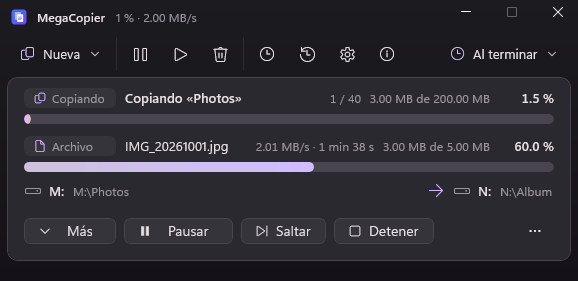
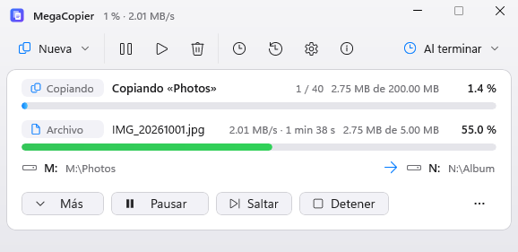
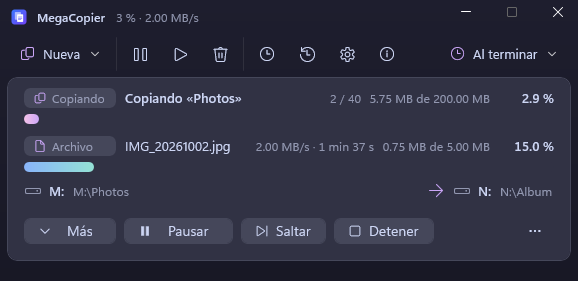
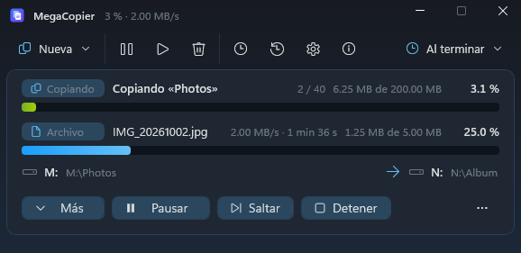
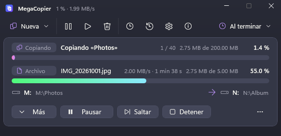
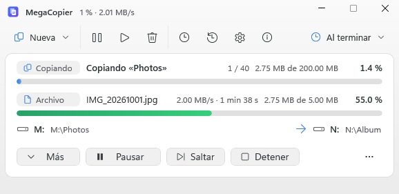

[English](README.md) · **Español** · Novedades: [Español](CHANGELOG.md) / [English](CHANGELOG.en.md)

<div align="center">


# MegaCopier

**El copiador de archivos para Windows 11 que sobrevive a los apagones.**

Sustituye al copiar y pegar del Explorador. Si la copia se corta (apagón, cuelgue, USB desconectado), sigue desde el
último bloque comprobado, también dentro de un archivo enorme, sin corromperlo. Y además verifica, sincroniza, hace
copias de seguridad y copia a servidores, nubes y móviles.

[](https://github.com/cbatista96/MegaCopier/actions/workflows/ci.yml)
[](https://github.com/cbatista96/MegaCopier/releases/latest)
[](https://github.com/cbatista96/MegaCopier/releases)
[](LICENSE)
[](#requisitos)
[](#todas-las-características)

### [⬇️ Descargar MegaCopier](https://github.com/cbatista96/MegaCopier/releases/latest)

### Code signing policy

La firma de actualizaciones usa una clave ECDSA propia. La firma Authenticode con SignPath Foundation se solicitó el 21 de octubre de 2026 y está pendiente de aprobación; no se anuncia todavía como concedida. Consulta la [política de firma](docs/Code-signing-policy.md) y la [política de privacidad](docs/Privacidad.md) ([English](docs/Privacy.md)).

[Características](#todas-las-características) ·
[Capturas](#capturas) ·
[Guía de uso](docs/Guia.md) ·
[Novedades](CHANGELOG.md) ·
[Comparativa](docs/Comparativa-copiadores.md) ·
[Preguntas frecuentes](docs/Preguntas-frecuentes.md) ·
[English](README.md)


</div>

---

> **Estado del código:** `main` incluye cambios todavía sin publicar como versión descargable. Consulta el [resumen y registro de desarrollo](CHANGELOG.md#sin-publicar) ([English](CHANGELOG.en.md#unreleased)). La descarga sigue correspondiendo a la última versión publicada.

## Por qué MegaCopier

| | |
|---|---|
| ⚡ **Reanuda tras un apagón** | Copia por bloques y anota cada uno solo cuando está de verdad en el disco. Al volver, comprueba lo ya copiado y sigue **dentro del mismo archivo**. Como mucho se repite un bloque. |
| 🚀 **Rápido** | E/S directa al disco en paralelo, colas por disco, clonado instantáneo en ReFS, copia en el propio servidor por red. La velocidad depende del equipo, el trabajo y las opciones; las capturas son demostraciones y no pruebas de rendimiento. |
| ✅ **Comprueba lo que copia** | Relee el destino sin caché, compara sumas (BLAKE3, SHA-256, xxHash…) y **repara** los bloques dañados. |
| 🛡️ **Protege tus copias** | Escudo contra ransomware, datos de recuperación que reparan la copia si el disco la estropea, versiones con limpieza automática y copias de seguridad sin duplicados. |
| 🌍 **Llega a todas partes** | Móviles y cámaras por USB, LocalSend, otro PC, FTP, SFTP, WebDAV, S3, OneDrive, Google Drive y Dropbox. |
| 🪟 **Integrado en Windows** | Ctrl+V, menú contextual (también el corto de Windows 11) y arrastrar con cualquier botón. Un doble clic en la bandeja lo activa o lo desactiva. |
| 🔒 **Privacidad** | Informes de errores opcionales con trazas filtradas. El instalador ofrece el envío seleccionado y permite desmarcarlo; Ajustes permite cambiarlo. Las actualizaciones silenciosas conservan tu elección. La búsqueda de actualizaciones consulta GitHub y se puede desactivar; correo y webhooks solo si los configuras. |
| 🎨 **A tu gusto** | 73 temas (con texturas y degradados), 22 estilos de barra de progreso, 29 conjuntos de iconos combinables (también al estilo de Android, Material You, One UI, Nothing, macOS, Linux y Windows de 95 a 8), 19 sonidos propios, editor de colores, 14 idiomas, consola `mcopy` y versión portátil. |

---

## Descargar e instalar

Todo está en la página de la **[última versión](https://github.com/cbatista96/MegaCopier/releases/latest)**:

| Archivo | Para qué |
|---|---|
| `MegaCopier-Setup-<versión>.exe` | **El instalador. Es el que necesita casi todo el mundo.** |
| `MegaCopier-<versión>-portable.zip` | Versión portátil: se descomprime donde quieras (también en un USB) y no se instala. |
| `mcopy-<versión>.exe` | Solo la consola, para scripts y servidores (no hace falta si instalas MegaCopier: ya la incluye). |
| `SHA256SUMS.txt` | Las sumas SHA-256 de los archivos, para comprobar que son los originales. |

1. Descarga y ejecuta `MegaCopier-Setup-<versión>.exe`.
2. Se instala **solo para tu usuario** en `%LOCALAPPDATA%\Programs\MegaCopier`: no pide permisos de administrador y lleva
   todo lo que necesita (no instala .NET ni nada más).
3. Durante la instalación eliges si añadir las opciones al menú del Explorador y si arrancar con Windows (recomendado).

> [!NOTE]
> El instalador todavía no está firmado digitalmente, así que Windows mostrará el aviso de **SmartScreen**. Pulsa
> **Más información** y luego **Ejecutar de todas formas**. Si quieres comprobar que el archivo es el original, compara su
> suma con la de `SHA256SUMS.txt`:
>
> ```powershell
> Get-FileHash .\MegaCopier-Setup-1.0.0.exe -Algorithm SHA256
> ```

**Versión portátil:** descomprime el ZIP y ejecuta `MegaCopier.exe`. Guarda los ajustes en la carpeta `Data` de al lado y
no toca el registro ni el Explorador (para eso, usa el instalador).

**Actualizaciones:** en *Ajustes > Actualizaciones* puedes buscar, descargar e instalar, ver las novedades y consultar todo el historial dentro de la app. La descarga automática respeta los permisos de red; la instalación automática es opcional y viene desactivada. Consulta [la guía](docs/Guia.md#actualizaciones). Historial: [español](CHANGELOG.md) · [English](CHANGELOG.en.md).

**Informes de errores y privacidad:** en *Ajustes > Avanzado* puedes abrir el registro local y revisar el último informe filtrado. El instalador ofrece el envío automático seleccionado en instalaciones nuevas; puedes desmarcarlo y las actualizaciones conservan tu elección. El modo portátil comienza desactivado. Si el envío automático está activo, se envía en segundo plano sin preguntar; si está desactivado, puedes revisar el JSON, enviar una vez o autorizar futuros envíos. Al desactivar la opción se borran los pendientes locales. No se adjuntan archivos, rutas, nombres ni mensajes libres. Cloudflare recibe la IP de conexión para limitar abusos; no se añade al informe ni a las incidencias privadas de GitHub. [Detalles y límites](docs/Guia.md#informes-de-errores) · [Configuración del receptor](tools/informes-worker/README.md).

**Desinstalar:** *Configuración > Aplicaciones > MegaCopier > Desinstalar*. Al final pregunta si quieres borrar también tus
ajustes e historial.

### Requisitos

- Windows 11 de 64 bits (x64).
- Incluye su propio entorno de ejecución: no necesitas instalar .NET por separado. Las copias locales funcionan sin Internet ni cuentas; los destinos remotos y las descargas necesitan su conexión.

---

## Actualizaciones e informes

La versión en desarrollo busca actualizaciones cada 48 horas cuando está habilitado. Descargar e instalar son opciones independientes desactivadas por defecto; las descargas respetan Wi-Fi, cable y redes de uso medido. Las novedades usan español para la interfaz española e inglés para las demás, incluidas versiones anteriores.

Los informes automáticos opcionales de cierres no son el registro local de una copia ni un detector de todas las vulnerabilidades. El instalador permite elegir y Ajustes > Avanzado permite cambiarlo. Consulta [Privacidad](docs/Privacidad.md) y [Seguridad](SECURITY.es.md).

## Uso rápido

1. **Copia y pega como siempre** (Ctrl+C / Ctrl+V, o Ctrl+X para mover) en el Explorador. La copia la hace MegaCopier.
2. Se abre una **ventana compacta** con el progreso. **«Más»** la amplía a la vista completa, con la lista de archivos.
3. Si se corta la luz, al volver a encender aparece la copia como **interrumpida**: pulsa **Continuar**.
4. **Doble clic en el icono de la bandeja** para activar o desactivar MegaCopier (desactivado, copia el Explorador).

Desde la consola:

```text
mcopy copy D:\Fotos E:\Copias --verify          copia y comprueba
mcopy move D:\Descargas\Vídeos E:\Vídeos       mueve (instantáneo en el mismo disco)
mcopy copy D:\Trabajo F:\Espejo --mirror        deja F:\Espejo igual que D:\Trabajo
mcopy backup D:\Documentos F:\CopiasSeguridad   copia de seguridad sin duplicados
mcopy restore F:\CopiasSeguridad latest D:\Recuperado
mcopy                                           muestra todas las opciones
```

Todo explicado paso a paso en la **[guía de uso](docs/Guia.md)**.

---

Las siguientes capturas se toman con la interfaz en español y datos locales de demostración. Los temas, iconos y barras corresponden a cada ejemplo; no son mediciones de rendimiento.

## Capturas

<table>
<tr>
<td width="50%"><br><b>Ventana compacta</b>: lo justo mientras copia.</td>
<td width="50%"><br><b>Tras un apagón</b>: la copia espera a que pulses <i>Continuar</i>.</td>
</tr>
<tr>
<td><br><b>Reanudada</b>: continúa aprovechando los datos ya copiados.</td>
<td><br><b>Si el archivo ya existe</b>: compara los dos y eliges.</td>
</tr>
<tr>
<td><br><b>Vista completa</b> en modo claro: copias a la izquierda, archivos a la derecha.</td>
<td><br><b>Comparar y sincronizar</b> dos carpetas antes de tocar nada.</td>
</tr>
<tr>
<td><br><b>Ventana ampliada</b>: gráfica de velocidad y resumen.</td>
<td><br><b>Opciones de cada copia</b>, también con la copia en marcha.</td>
</tr>
<tr>
<td><br><b>Historial</b> con repetir, deshacer y «copiar de vuelta».</td>
<td><br><b>Línea de tiempo</b>: cuándo terminará cada copia de la cola.</td>
</tr>
<tr>
<td><br><b>Al terminar</b>: resumen, «Abrir carpeta» y lo omitido.</td>
<td><br><b>Ajustes</b> como la Configuración de Windows 11: secciones, buscador e iconos.</td>
</tr>
<tr>
<td><br><b>Comportamiento</b>: sumar copias, borrar lo que quedó a medias, expulsar el USB.</td>
<td><br><b>Errores</b>: preguntar qué hacer, reintentos e informe de errores.</td>
</tr>
<tr>
<td colspan="2"><br>Tema <b>Madera</b> con los iconos <b>Mosaico</b>: cualquier tema con cualquier conjunto de iconos.</td>

</tr>
</table>

### Temas

**73 temas** que cambian toda la interfaz al momento, hasta los botones, los menús y las barras de desplazamiento. Todos
están diseñados para Windows 11, con degradados, y algunos tienen textura de fondo.
Además, un editor para crear los tuyos.

<table>
<tr>
<td width="33%"><br>Combustión</td>
<td width="33%"><br>Código verde</td>
<td width="33%"><br>Aurora</td>
</tr>
<tr>
<td><br>Galaxia</td>
<td><br>Neón</td>
<td><br>Caja negra</td>
</tr>
<tr>
<td><br>Madera</td>
<td><br>Cuaderno</td>
<td><br>Cristal</td>
</tr>
<tr>
<td><br>Burbuja azul</td>
<td><br>Berenjena</td>
<td><br>Humo</td>
</tr>
<tr>
<td><br>Cobalto</td>
<td><br>Metro oscuro</td>
<td><br>Aero</td>
</tr>
<tr>
<td><br>Luna</td>
<td><br>Aire</td>
<td><br>Menta</td>
</tr>
<tr>
<td><br>Fluent oscuro</td>
<td><br>Fluent claro</td>
<td><br>Medianoche</td>
</tr>
<tr>
<td><br>Océano</td>
<td><br>Bosque</td>
<td><br>Atardecer</td>
</tr>
<tr>
<td><br>Azul clásico</td>
<td><br>Gris clásico</td>
<td><br>Alto contraste</td>
</tr>
</table>

Y otros 24: Grafito, Robot verde, Cielo de otoño, Ámbar, Granate, Vapor, Metro gris, Televisión, Reproductor,
Esmeralda, Mandarina, Metro claro, Pez azul, Línea plana, Plus, Cielo, Brillo, Nieve, Burbuja lima, Tóxico,
Naranja tierra, Moderno 8, Mensajero y Plata. **Fluent (como Windows)** sigue el modo claro u oscuro y el color de acento
de Windows.

Nuevos en la 1.2, con el aire de los escritorios y las apps de hoy: Material oscuro y claro, Cobre oscuro y claro, Silicio
oscuro y claro, Brisa oscura y clara, Pizarra, Tiza, Arcade, Ártico, Vampiro, Capuchino y Capuchino claro, Noche de Tokio,
Retro cálido, Solar oscuro y claro, Átomo y Menta oscura.

<table>
<tr>
<td><br>Material oscuro</td>
<td><br>Silicio claro</td>
<td><br>Capuchino</td>
</tr>
<tr>
<td><br>Arcade</td>
<td><br>Vampiro</td>
<td><br>Tiza</td>
</tr>
</table>

### Conjuntos de iconos

Siete estilos de iconos, todos con los iconos modernos de Windows 11, que se combinan con cualquier tema:

<table>
<tr>
<td width="50%"><br><b>Fluent</b>: como Windows.</td>
<td width="50%"><br><b>Color</b>: cada icono con su color.</td>
</tr>
<tr>
<td><br><b>Mosaico</b>: sobre un cuadrado de color, como la Configuración de Windows 11.</td>
<td><br><b>Suave</b>: con un fondo suave de su color.</td>
</tr>
<tr>
<td><br><b>Degradado</b>: con los colores de las barras del tema.</td>
<td><br><b>Neón</b>: con un halo de luz.</td>
</tr>
<tr>
<td colspan="2"><br><b>Windows 10</b>: los iconos clásicos.</td>
</tr>
</table>

### Barras de progreso

**22 estilos**, cada uno con su animación, y cada barra (la del total, la del archivo y las de la lista) con el suyo:
Fluent, Aero (con el reflejo que pasa una y otra vez), Ola, Rayas en movimiento, Neón, Bloques, LED, Arcoíris, Latido,
Cometa, Cristal, Fuego, Terminal, Línea fina, Doble capa, Píxeles, Metal, Contorno, Degradado fluido, Burbujas, Semáforo y
Segmentos. Además: colores propios, semáforo o arcoíris, grosor, redondeo, velocidad de los efectos, brillo, porcentaje
dentro de la barra, avance elástico o a saltos y efectos según el estado (rayas en pausa, sacudida con error y destello al
terminar).


---

## Todas las características

### Copia que no se pierde
- **Reanudación tras un apagón** dentro del propio archivo: cada bloque se escribe en el disco y solo después se anota con
  su suma en un diario. Al volver se comprueba lo ya copiado y se sigue; como mucho se pierde un bloque.
- Las copias interrumpidas aparecen al arrancar y se continúan con un clic (o solas, si lo activas).
- **Pausar, saltar el archivo actual, detener y seguir más tarde**; reintentos automáticos y lista de fallidos.
- **Espera** a que vuelva el disco, la red o el espacio libre, en vez de fallar.
- **Comprueba que cabe** antes de copiar (y al añadir a una copia en marcha): si no, cancelar o forzar la copia, que
  llena el disco y espera a que haya sitio.
- Carpetas **«todo o nada»**: o se copian enteras o no queda nada a medias.
- **Modo rescate** para discos dañados: salva lo legible y deja en ceros lo ilegible.
- **Archivos en uso** (Outlook, bases de datos) copiados desde una instantánea de Windows (VSS).
- **Modo copia de seguridad**: salta los permisos (con permiso de administrador).
- **Archivos cifrados con EFS** copiados tal cual, sin descifrarlos.

### Comprobación y protección
- **Verificación** releyendo el destino sin caché, con **reparación** de los bloques dañados.
- 11 algoritmos de suma: CRC32, xxHash3/64/128, MD5, SHA-1, SHA-256/512, SHA3-256/512 y BLAKE3.
- Crear y comprobar archivos de sumas (`.sha256`, `.md5`, `.sfv`, `.b3`, `.xxh3`…).
- **Guardián de integridad**: guarda la suma de cada archivo y revisa tus carpetas cada cierto tiempo contra la corrupción
  silenciosa del disco.
- **Escudo contra ransomware**: si muchos archivos que van a sobrescribir una copia buena parecen cifrados de repente, la
  copia se para antes de estropear también la copia buena.
- **Datos de recuperación** (paridad Reed-Solomon, como PAR2): si el disco estropea bloques de la copia, se reconstruyen sin
  necesitar el original (`mcopy repair`).
- **Modo forense**: manifiesto firmado (ECDSA) con la SHA-256 de cada archivo, quién y cuándo, comprobable con
  `mcopy verify-manifest`.

### Velocidad
- E/S directa al disco, asíncrona y en paralelo, con colas por disco físico.
- Archivos pequeños en paralelo e IoRing para leer muchos a la vez.
- **Autoajuste por disco**: mide cada disco y elige el tamaño de bloque y las colas.
- **Clonado instantáneo** en ReFS y en las unidades de desarrollo de Windows 11.
- **Copia en el propio servidor** y compresión SMB en red.
- **Copia delta**: al reemplazar archivos grandes solo escribe los bloques que cambiaron (y se puede deshacer).
- **Varios orígenes a la vez**: si lo mismo está en dos NAS o dos PC, los archivos grandes se leen de todos.
- Hasta 255 conexiones con servidores y nubes, **ajustadas solas** según la velocidad.
- ZIP y 7z **comprimidos en paralelo** en varios núcleos.
- **Límite de velocidad en vivo** para cada copia, con un deslizador que se aplica al momento.
- Exclusión opcional de Windows Defender, prioridad baja, pausa con batería o con juegos y horario.

### Qué y cómo copiar
- Modos: copiar, mover, **espejo**, solo actualizar, solo carpetas y **organizar fotos por fecha** de la cámara.
- **Simulación** («qué pasaría») y después «hacerlo de verdad».
- **Filtros** por nombre, tamaño, fecha y atributos, también **en lenguaje normal** («fotos de más de 2 MB del último mes
  sin los .tmp») y **por el texto que contienen las fotos** (OCR de Windows, sin internet).
- **Conflictos**: preguntar (con miniaturas), reemplazar, omitir, el más reciente, conservar ambos o renombrar con un patrón.
- **Carpeta que ya existe**: antes de empezar, pasar los archivos que ya están (copia solo los que faltan), sobrescribir,
  copiar con otro nombre, preguntar uno por uno o cancelar.
- Omitir **fotos duplicadas** (mismo contenido, cualquier nombre).
- Permisos, propietario, flujos alternativos, atributos, fechas, enlaces simbólicos, uniones, enlaces duros, archivos
  dispersos y rutas de más de 260 caracteres.
- **Carpeta de versiones** para lo que se sobrescribe o se quita, con **limpieza automática** (días, semanas y meses).
- **Copias de seguridad sin duplicados**: diez copias de algo que apenas cambia ocupan poco más que una, y se puede
  restaurar cualquiera.
- **Cifrado**: copia cifrada AES-256 (`.mcenc`), a **ZIP cifrado** (lo abren 7-Zip y WinRAR) o a **7z cifrado**, que oculta
  también los nombres.
- **Borrado seguro**: ceros, aleatorio, DoD de 3 pasadas o DoD de 7 pasadas.

### Comportamiento y errores
- **Si un archivo sigue fallando, preguntar qué hacer**: reintentar, omitir, omitir todos los siguientes o detener (o
  decidirlo de antemano: omitir, detener o reintentar al final).
- **Copias nuevas mientras otra está en marcha**: al mismo disco, MegaCopier pregunta si añadirla a la copia en marcha
  (cada cosa a su carpeta) o hacerla aparte; a otro disco, empieza a la vez. Ambas cosas se pueden cambiar.
- **Cada copia en su propia ventana** (opcional): una ventana por copia, que empieza ya, con el mismo tema en todas y su
  icono de progreso en la bandeja.
- **Informe de errores** automático al terminar con problemas, en la carpeta de destino o en una fija.
- **Expulsar la unidad de destino** (USB, tarjeta) al terminar, también a la fuerza.
- **Al detener una copia, borrar lo que quedó a medias** (salvo si paró por un error).
- Atributos y permisos que se conservan **al mover**, aparte de los de copiar.
- Icono de la bandeja opcional, **un icono de progreso por copia en la bandeja**, qué hacen la X (cancelar, detener,
  ocultar o salir) y minimizar (barra de tareas o bandeja), empezar las copias minimizadas, recordar la posición y el
  tamaño de la ventana, fondo de la ventana (el del tema, Mica, Mica Alt, acrílico o translúcida) y ajuste a pantallas
  pequeñas (1366 × 768).

### Sincronizar
- **Espejo** de una carpeta en otra.
- **Sincronización en los dos sentidos** que recuerda el estado anterior, detecta borrados y **renombrados o movidos** (los
  renombra en el otro lado sin volver a copiarlos); lo sustituido va a la Papelera.
- **Vista de comparación** lado a lado antes de sincronizar, eligiendo qué se hace con cada archivo.
- **Sincronización en tiempo real**: vigila una carpeta y copia cada cambio al momento.

### Dónde copiar
- Discos, USB y carpetas de red.
- **Móviles y cámaras** por USB (MTP), en los dos sentidos.
- **LocalSend** (app gratuita para iPhone y Android): recibir del móvil y **enviar al móvil**.
- **Otro PC con MegaCopier** por la red local, cifrado y con código.
- **Servidores**: FTP, FTPS, SFTP, WebDAV (Nextcloud, ownCloud, NAS…) y S3 y compatibles (AWS, Backblaze B2, Cloudflare R2,
  Wasabi, MinIO).
- **Nubes**: OneDrive, Google Drive y Dropbox, con inicio de sesión en el navegador ([cómo conectarlas](docs/Nube.md)).
- Contraseñas y tokens guardados en el Administrador de credenciales de Windows, nunca en archivos.

### Uso diario
- Sustituye **Ctrl+V**, el **menú contextual** (también el corto de Windows 11) y el **arrastre** del Explorador.
- **Varios destinos a la vez**, favoritos, recientes y las carpetas abiertas en el Explorador, Total Commander y Directory Opus.
- **Cola por disco**: en el mismo disco, de una en una; en discos distintos, a la vez. Se reordena arrastrando.
- **Lista de archivos de cada copia** con origen, tamaño y destino, selección múltiple y botones para llevar al principio,
  subir, bajar, llevar al final, añadir y quitar. Soltar archivos en la copia los añade al final (o donde marque la línea).
- **Guardar la lista** con lo que falta y **cargarla** para seguir donde quedó; si el destino ya no está, se elige otro.
- **Línea de tiempo** de la cola y **bandeja de arrastre** para ir juntando archivos.
- **Tareas programadas** (una vez, diarias, semanales o mensuales) que se hacen al encender si el PC estaba apagado.
- **Historial** con repetir, deshacer y «copiar de vuelta».
- **Aviso SMART** de discos que empiezan a fallar.
- Avisos al terminar por **correo** y **webhook**; al terminar, apagar, suspender, hibernar o ejecutar un programa.
- **Control desde el móvil**: página web en la red local, con código, para ver, pausar, seguir o detener copias.
- **Asistentes de IA**: servidor MCP (`mcopy mcp`) para que Claude, Copilot y otros pidan copias y copias de seguridad.
- Informes HTML y CSV, listas de copia guardadas y registros.
- **Consola `mcopy`** con todas las funciones y **versión portátil**.
- **14 idiomas**: español, inglés, francés, alemán, italiano, portugués de Brasil, ruso, ucraniano, polaco, neerlandés,
  turco, chino, japonés y coreano.
- **73 temas** que colorean toda la interfaz (hasta las barras de desplazamiento), con degradados y texturas, **22 estilos de barra de progreso**, **29 conjuntos de iconos** que se combinan con cualquier tema, editor de colores, **19 sonidos propios** y modo claro u oscuro; accesible con lectores de pantalla.
- **Ajustes como la Configuración de Windows 11**: secciones a la izquierda, buscador, iconos, animaciones y un botón ⓘ que
  explica las opciones complejas con ejemplos de uso.

Cada característica explicada en detalle: **[Características](docs/Caracteristicas.md)**. Cómo se compara con TeraCopy,
FastCopy, Ultracopier, robocopy y otros: **[Comparativa](docs/Comparativa-copiadores.md)**.

---

## Documentación

| Documento | Qué contiene |
|---|---|
| [Guía de uso](docs/Guia.md) | Todo MegaCopier paso a paso: copiar, la ventana, sincronizar, copias de seguridad, servidores, móviles, ajustes y consola. |
| [Características](docs/Caracteristicas.md) | La lista completa, explicada. |
| [Preguntas frecuentes](docs/Preguntas-frecuentes.md) | SmartScreen, apagones, velocidad, desinstalar, problemas habituales. |
| [Nubes](docs/Nube.md) | Cómo conectar OneDrive, Google Drive y Dropbox. |
| [Integraciones](docs/Integraciones.md) | Total Commander, Directory Opus y asistentes de IA (MCP). |
| [Comparativa](docs/Comparativa-copiadores.md) | MegaCopier frente a otros copiadores. |
| [Novedades](CHANGELOG.md) | Qué cambia en cada versión. |
| [Versiones](docs/Versiones.md) | Cómo se numeran y publican las versiones. |
| [Compilar](docs/Compilar.md) | Compilar desde el código, pruebas y arquitectura. |

---

## Versiones y novedades

MegaCopier sigue el [versionado semántico](https://semver.org/lang/es/): **1.2.3** = versión principal . nueva función .
arreglo. Cada versión publicada tiene su página en
**[Releases](https://github.com/cbatista96/MegaCopier/releases)** con sus novedades y sus archivos, y todos los cambios
están en **[CHANGELOG.md](CHANGELOG.md)**. Cómo se publica cada versión: [docs/Versiones.md](docs/Versiones.md).

Para enterarte de las versiones nuevas: botón **Watch > Custom > Releases** arriba en esta página.

---

## Compilar desde el código

```powershell
git clone https://github.com/cbatista96/MegaCopier.git
cd MegaCopier
.\build.ps1             # textos, pruebas, app, extensión del Explorador, consola e instalador
```

Requisitos (todo gratis: .NET 10 SDK, herramientas de C++ e Inno Setup) e instrucciones en **[Compilar.md](docs/Compilar.md)**.

## Contribuir

Las contribuciones son bienvenidas: avisos de fallos, ideas, traducciones y código. Lee **[CONTRIBUTING.md](CONTRIBUTING.md)**
antes de enviar cambios. Los informes automáticos opcionales comunican cierres y fallos de ejecución filtrados. No detectan todas las vulnerabilidades de seguridad ni sustituyen su comunicación privada: **[SECURITY.es.md](SECURITY.es.md)**.

## Licencia

MegaCopier es software libre con licencia **[GNU GPL v3](LICENSE)**: puedes usarlo, estudiarlo, modificarlo y
compartirlo; si distribuyes una versión modificada, tiene que seguir siendo libre y con la misma licencia.
