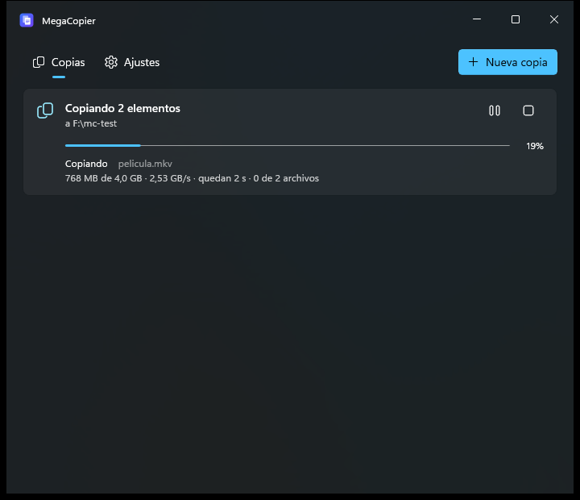

# MegaCopier

Copiador de archivos para Windows 11 cuya prioridad es que **una copia interrumpida (apagón, cuelgue, USB desconectado)
continúe desde donde quedó, sin corromper el archivo**. Sustituye al Ctrl+V del Explorador, arranca al instante y es
más rápido que el Explorador y robocopy entre discos NVMe.



## Instalar

Ejecuta `artifacts\installer\MegaCopier-Setup-1.0.0.exe` (≈17 MB). Se instala **solo para tu usuario** en
`%LOCALAPPDATA%\Programs\MegaCopier`, sin pedir permisos de administrador y sin instalar nada más (lleva su propio runtime).
Durante la instalación puedes elegir:

- Añadir «Pegar con MegaCopier» y «Copiar / Mover aquí» al Explorador.
- Iniciar con Windows (recomendado: queda en la bandeja y las copias empiezan al instante).

Se desinstala desde *Configuración > Aplicaciones* y no deja nada en el registro.

> El instalador no está firmado: Windows mostrará el aviso de SmartScreen («Más información» → «Ejecutar de todas
> formas»). Firmarlo (p. ej. con Azure Trusted Signing) elimina el aviso.

## Qué hace

**Copiar y mover desde el Explorador**
- **Ctrl+C / Ctrl+X → Ctrl+V** en el Explorador o el Escritorio: lo hace MegaCopier. Solo actúa cuando el foco está en la
  lista de archivos (nunca en la barra de direcciones, la búsqueda o al renombrar). Pegar en la misma carpeta y las
  carpetas virtuales (Este equipo, ZIP…) siguen con el Explorador.
- **Menú contextual** «Pegar con MegaCopier» y **arrastrar con el botón derecho** «Copiar aquí» / «Mover aquí».
- **Mover**: en el mismo disco es un renombrado instantáneo (2 GB en 16 ms); entre discos se copia y el original solo se
  borra cuando su copia está completa.

**Reanudación tras un apagón** (el corazón del proyecto)
1. Nunca se escribe en el nombre final: se copia a `archivo.ext.mcpart`.
2. Por bloques de 64 MB: los datos se vacían al disco (`FlushFileBuffers`) y **solo después** se anota el bloque y su
   hash XxHash128 en `archivo.ext.mcjournal`.
3. Al reanudar manda el journal, no el tamaño del archivo: se descartan registros rotos (CRC32 por registro), se
   comprueba que el origen no cambió y se releen del disco los últimos bloques por si el disco "mintió".
4. Al terminar: fechas y atributos, renombrado atómico al nombre final y borrado del journal.

Tras un apagón se pierde como máximo un bloque. Al volver a abrir MegaCopier, las copias a medias aparecen como
*interrumpidas* (con aviso del sistema) y se continúan con un clic, o solas si se activa en Ajustes.

**Durante la copia**
- Ventana de progreso con velocidad, tiempo restante y archivo actual; progreso también en la barra de tareas y la bandeja.
- Pausar, detener (reanudable) y descartar; cola por **disco físico** (dos copias en el mismo disco esperan turno; en
  discos distintos van en paralelo).
- **Si el archivo ya existe**: pregunta con un diálogo que compara ambos archivos (reemplazar / conservar ambos /
  omitir, con «hacer lo mismo con todos»), o una política fija.
- Verificación opcional sin caché con **reparación** de bloques dañados; lista de archivos con errores y «Reintentar».
- Límite de velocidad; **al terminar**: suspender o apagar el equipo.

**Personalización**: tema claro/oscuro/sistema, 7 colores de acento, fondo Mica / Mica Alt / Acrílico / sólido,
«siempre visible» e **idioma español / inglés** (también en las opciones del Explorador).


## Rendimiento

E/S asíncrona sin caché con **4 lecturas y 4 escrituras simultáneas** de bloques de 4 MB; el hash se calcula en orden
mientras las escrituras siguen en curso. Medido el 15/10/2026 con 4 GB, contando hasta que los datos están en el disco:

| | MegaCopier | robocopy |
|---|---|---|
| Entre dos NVMe (990 EVO → 990 EVO Plus) | 3.050–3.900 MB/s | 1.800–2.290 MB/s |
| Verificación (relectura sin caché + hash) | ~6.800 MB/s | — |
| Mismo NVMe | 460–1.140 MB/s | 460–900 MB/s |

En el mismo disco manda el SSD (tras agotar su caché SLC baja a ~500 MB/s con cualquier programa).

| Arranque | Tiempo |
|---|---|
| App en la bandeja: Ctrl+V → copia en marcha | 4–33 ms |
| App en la bandeja: Ctrl+V → ventana visible | 32–112 ms |
| App cerrada: petición → app abierta y ventana visible | 279–477 ms |

## Compilar

Requisitos (todo gratis y sin abrir Visual Studio):

```powershell
winget install Microsoft.DotNet.SDK.10
winget install Microsoft.VisualStudio.2022.BuildTools --override "--quiet --add Microsoft.VisualStudio.Workload.VCTools --includeRecommended"
winget install JRSoftware.InnoSetup
```

```powershell
.\build.ps1            # textos + pruebas + app + extensión + consola + instalador
.\build.ps1 -SkipTests
```

Resultado: `artifacts\app\MegaCopier.exe` (se puede ejecutar sin instalar), `artifacts\cli\mcopy.exe` y
`artifacts\installer\MegaCopier-Setup-<versión>.exe`. La versión está en `Directory.Build.props`.

### Textos e idiomas

Todos los textos están en `tools\Strings\strings.tsv` (clave, español, inglés). `build.ps1` genera con ellos
`src\MegaCopier.App\Strings\<idioma>\Resources.resw`; no edites los `.resw` a mano. En el XAML se usan con `x:Uid` y en
el código con `L.Get("Clave")`. Para añadir un idioma, añade una columna al `.tsv`.

## Herramienta de consola

```text
mcopy copy <origen>... <destino> [--verify] [--conflict overwrite|skip|newer|rename|fail|ask] [--force] [--limit-mb n]
mcopy move <origen>... <destino> [mismas opciones]
mcopy send <origen>... <destino> [--verify] [--move]     entrega la copia a la app (la arranca si está cerrada)
mcopy resume [id]                                        continúa trabajos interrumpidos
mcopy jobs
```

Para probar la reanudación: `--crash-after-mb 2000` mata el proceso tras confirmar 2000 MB. Matar el proceso no equivale
a un apagón (Windows sigue vaciando su caché): para una prueba real hay que apagar de golpe una máquina virtual de Hyper-V.

## Arquitectura

| Proyecto | Qué contiene |
|---|---|
| `src/MegaCopier.Engine` | Motor: journal, E/S sin caché, mover, conflictos, reintentos, cola por disco y protocolo IPC. |
| `src/MegaCopier.App` | App WinUI 3 (Windows App SDK 2.x, sin MSIX, Native AOT): proceso residente, bandeja (Win32 directo), ventana y ajustes. |
| `src/MegaCopier.Shell` | Integración con el Explorador desde la app: gancho de Ctrl+V, portapapeles, carpeta de la pestaña activa (COM), registro de la extensión. |
| `src/MegaCopier.ShellExt` | Extensión del Explorador en C++ (menú contextual y arrastrar con el botón derecho). |
| `src/MegaCopier.Cli` | Consola `mcopy`. |
| `tests/MegaCopier.Engine.Tests` | 47 pruebas: cortes simulados en cada punto crítico, journal dañado, mover, conflictos, cola e IPC. |
| `installer/MegaCopier.iss` | Instalador Inno Setup por usuario. |
| `tools/` | Generadores del icono y de los textos. |

La app es **instancia única por usuario**: el primer proceso queda residente y cualquier otro (la extensión, `mcopy`,
un segundo `MegaCopier.exe`) le entrega la petición por la tubería `\\.\pipe\MegaCopier-<SID>` (longitud + JSON UTF-8).

## Limitaciones conocidas

- **Arrastrar con el botón izquierdo** no se intercepta: Windows no ofrece una forma documentada sin inyectar código en
  el Explorador. Arrastrar con el botón derecho sí ofrece «Copiar / Mover aquí con MegaCopier».
- En el **menú contextual compacto** de Windows 11 las opciones aparecen bajo «Mostrar más opciones»: el menú compacto
  exige que la app esté empaquetada y firmada.
- Cambiar el **color de acento** o el **idioma** requiere reiniciar MegaCopier (la app lo ofrece con un botón).
- Los mensajes de error internos del motor están en español.
- No se ha probado todavía un **apagón real** (solo procesos matados y fallos simulados en las pruebas).
