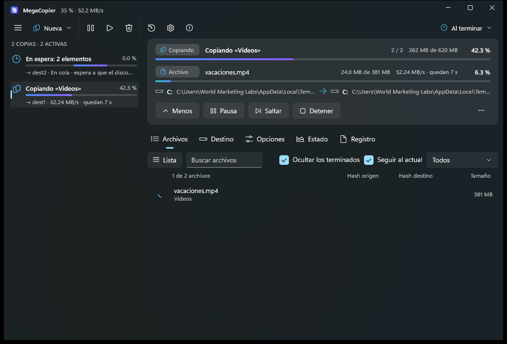

<div align="center">


# MegaCopier

**El copiador de archivos para Windows que sobrevive a los apagones.**

Sustituye al copiar y pegar del Explorador. Si la copia se corta (apagón, cuelgue, USB desconectado), sigue
desde el último bloque comprobado, también dentro de un archivo enorme, sin corromperlo.

[](https://github.com/cbatista96/MegaCopier/actions/workflows/ci.yml)
[](https://github.com/cbatista96/MegaCopier/releases/latest)
[](LICENSE)


**[Descargar](https://github.com/cbatista96/MegaCopier/releases/latest)** ·
[Características](docs/Caracteristicas.md) ·
[Guía de uso](docs/Guia.md) ·
[Comparativa](docs/Comparativa-copiadores.md) ·
[Novedades](CHANGELOG.md) ·
[English](#english)



</div>

## Por qué MegaCopier

- **Reanuda dentro de un archivo tras un apagón**, comprobando lo ya copiado. Ningún otro copiador lo hace igual.
- **Rápido:** E/S directa al disco en paralelo, clonado instantáneo en ReFS, copia en el propio servidor por red,
  archivos pequeños en paralelo. Entre dos NVMe: 3.050–3.900 MB/s, frente a 1.800–2.290 MB/s de robocopy.
- **Comprueba lo que copia:** relee el destino sin caché, compara sumas (BLAKE3, SHA-256, xxHash…) y repara bloques dañados.
- **Protege tus copias:** escudo contra ransomware, datos de recuperación que reparan la copia si el disco la estropea,
  versiones con limpieza automática y copias de seguridad sin duplicados.
- **Llega a todas partes:** móviles y cámaras por USB, LocalSend, FTP, SFTP, WebDAV, S3, OneDrive, Google Drive y Dropbox.
- **Integrado en Windows:** Ctrl+V, menú contextual (también el corto de Windows 11), arrastrar con cualquier botón.
- **Sin telemetría.** MegaCopier no envía nada a ningún sitio salvo lo que tú configures (avisos por correo o webhook).
- **14 idiomas**, 11 temas, modo claro y oscuro, consola `mcopy` y modo portátil.

La lista completa está en **[Características](docs/Caracteristicas.md)**.

## Descargar e instalar

1. Descarga `MegaCopier-Setup-<versión>.exe` de la **[última versión](https://github.com/cbatista96/MegaCopier/releases/latest)**.
2. Ejecútalo. Se instala **solo para tu usuario**, sin permisos de administrador y sin instalar nada más.

Requisitos: Windows 11 de 64 bits.

> El instalador todavía no está firmado digitalmente. Windows mostrará el aviso de SmartScreen: pulsa **Más información**
> y luego **Ejecutar de todas formas**. Cada versión publica la suma SHA-256 de sus archivos para comprobar que son los originales.

También hay una versión **portátil** (ZIP): descomprímela donde quieras y ejecuta `MegaCopier.exe`. Guarda sus ajustes
en una carpeta `Data` a su lado y no toca el registro.

## Uso rápido

- Copia y pega como siempre (**Ctrl+C / Ctrl+V**) en el Explorador: la copia la hace MegaCopier.
- **Doble clic en el icono de la bandeja** activa o desactiva MegaCopier (desactivado, copia el Explorador como siempre).
- Desde la consola:

```text
mcopy copy D:\Fotos E:\Copias --verify
mcopy backup D:\Documentos F:\CopiasDeSeguridad
mcopy restore F:\CopiasDeSeguridad latest D:\Recuperado
mcopy                                   (muestra todas las opciones)
```

Más en la **[guía de uso](docs/Guia.md)**, la [integración con otros programas y asistentes de IA](docs/Integraciones.md)
y [cómo conectar las nubes](docs/Nube.md).

## Compilar desde el código

Todo se compila desde la línea de comandos, sin abrir Visual Studio:

```powershell
.\build.ps1             # textos, pruebas, app, extensión del Explorador, consola e instalador
```

Requisitos e instrucciones en **[Compilar.md](docs/Compilar.md)**.

## Contribuir

Las contribuciones son bienvenidas: informes de errores, ideas, traducciones y código. Lee
**[CONTRIBUTING.md](CONTRIBUTING.md)** antes de enviar cambios. Para fallos de seguridad, sigue **[SECURITY.md](SECURITY.md)**.

## Licencia

MegaCopier es software libre bajo la **[GNU GPL v3](LICENSE)**: puedes usarlo, estudiarlo, modificarlo y distribuirlo,
y si distribuyes una versión modificada debe seguir siendo libre con la misma licencia.

---

## English

**MegaCopier** is a file copier for Windows that survives power cuts: if a copy is interrupted, it resumes from the last
verified block, even inside a huge file, without corrupting it. It replaces Explorer's copy and paste, verifies what it
copies, and adds ransomware protection, self-healing recovery data, deduplicated backups, phone and cloud transfers
(MTP, LocalSend, FTP, SFTP, WebDAV, S3, OneDrive, Google Drive, Dropbox), 14 languages and a `mcopy` command line.

- **Download:** [latest release](https://github.com/cbatista96/MegaCopier/releases/latest) (Windows 11, x64).
- **Documentation** is in Spanish (the app itself is translated into 14 languages): [features](docs/Caracteristicas.md),
  [guide](docs/Guia.md), [building](docs/Compilar.md).
- **License:** [GPL v3](LICENSE). Contributions welcome, see [CONTRIBUTING.md](CONTRIBUTING.md).
