# Guía de uso de MegaCopier

Todo MegaCopier explicado paso a paso. Si es tu primera vez, lee **[Instalar](#1-instalar)** y **[Copiar y pegar](#2-copiar-y-pegar-desde-el-explorador)**: con eso ya lo usas. El resto lo consultas cuando lo
necesites.

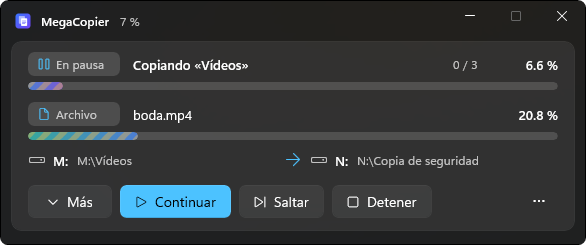

## Índice

1. [Instalar](#1-instalar)
2. [Copiar y pegar desde el Explorador](#2-copiar-y-pegar-desde-el-explorador)
3. [La ventana de copia](#3-la-ventana-de-copia)
4. [Si se va la luz: reanudar](#4-si-se-va-la-luz-reanudar)
5. [Si el archivo ya existe](#5-si-el-archivo-ya-existe)
6. [El menú «Nueva»](#6-el-menú-nueva)
7. [Varios destinos, favoritos y programar](#7-varios-destinos-favoritos-y-programar)
8. [Comprobar que la copia está bien](#8-comprobar-que-la-copia-está-bien)
9. [Sincronizar carpetas](#9-sincronizar-carpetas)
10. [Copias de seguridad y versiones](#10-copias-de-seguridad-y-versiones)
11. [Proteger tus copias](#11-proteger-tus-copias)
12. [Cifrar, comprimir y borrar de forma segura](#12-cifrar-comprimir-y-borrar-de-forma-segura)
13. [Móviles, otros equipos, servidores y nubes](#13-móviles-otros-equipos-servidores-y-nubes)
14. [La cola, la línea de tiempo y el historial](#14-la-cola-la-línea-de-tiempo-y-el-historial)
15. [Tareas programadas y avisos](#15-tareas-programadas-y-avisos)
16. [Controlar desde el móvil y con asistentes de IA](#16-controlar-desde-el-móvil-y-con-asistentes-de-ia)
17. [Ajustes](#17-ajustes)
18. [Temas, iconos y barras de progreso](#18-temas-iconos-y-barras-de-progreso)
19. [La consola `mcopy`](#19-la-consola-mcopy)
20. [Versión portátil](#20-versión-portátil)
21. [Cómo funciona por dentro](#21-cómo-funciona-por-dentro)
22. [Rendimiento](#22-rendimiento)
23. [Limitaciones conocidas](#23-limitaciones-conocidas)

---

## 1. Instalar

1. Entra en la página de la **[última versión](https://github.com/cbatista96/MegaCopier/releases/latest)** y descarga
   `MegaCopier-Setup-<versión>.exe` (unos 25 MB).
2. Ejecútalo. Como el instalador todavía no está firmado, Windows muestra el aviso de **SmartScreen**: pulsa
   **Más información** y luego **Ejecutar de todas formas**.
3. Elige las opciones:
   - **Añadir MegaCopier al menú del Explorador**: «Pegar con MegaCopier» y «Copiar / Mover aquí con MegaCopier».
   - **Iniciar con Windows** (recomendado): MegaCopier queda en la bandeja y las copias empiezan al instante.

Se instala **solo para tu usuario** en `%LOCALAPPDATA%\Programs\MegaCopier`, sin permisos de administrador y sin instalar
nada más (lleva dentro todo lo que necesita). Tus ajustes, temas e historial se guardan en `%LOCALAPPDATA%\MegaCopier`.

**Actualizar:** abre *Ajustes > Actualizaciones*. También puedes descargar el instalador de la versión nueva y ejecutarlo encima. Se conservan los ajustes y el historial.

### Actualizaciones

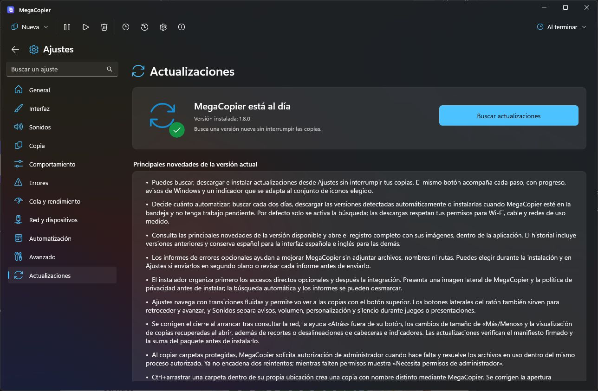

El botón principal conserva su tamaño y cambia según el estado: **Buscar actualizaciones**, **Estás al día**, **Descargar actualización** o **Actualizar ahora**. Mientras busca muestra una barra animada; durante la descarga muestra el progreso real y los bytes recibidos. Puedes cancelarla. No se instala nada al pulsar una notificación de Windows: solo abre esta sección.

La búsqueda automática viene activada y espera unos 30 segundos al arrancar. Solo consulta versiones cuando han pasado **48 horas** desde la última comprobación correcta. Si pasa ese plazo sin Internet, la búsqueda pendiente se recupera al reconectar. Entrar en Actualizaciones nunca inicia una búsqueda: presenta el último resultado guardado. Puedes desactivar la búsqueda automática y buscar con el botón en cualquier momento. Un indicador «1» aparece en Ajustes y en Actualizaciones mientras haya una versión pendiente; puedes descartarlo para esa versión.

**Descargar automáticamente** viene desactivado. Con búsqueda y descarga automáticas activadas, una versión detectada por una búsqueda automática se descarga en cuanto hay una red permitida y queda preparada para instalar. Una versión descubierta al pulsar **Buscar actualizaciones** ofrece **Descargar actualización**, aunque esté activada la descarga automática. No se espera dos días desde su publicación: el plazo de 48 horas corresponde a las comprobaciones. Cancelar una descarga impide nuevos intentos automáticos para esa versión hasta que decidas descargarla de nuevo.

Por defecto se permiten **Wi-Fi y Ethernet sin uso medido**. Las **redes móviles y de uso medido** requieren activar su propia casilla. Una Wi-Fi marcada como de uso medido sigue la segunda opción. Si solicitas una descarga manual en una red no permitida, puedes autorizarla solo esta vez. La aplicación detecta la conexión sin mostrar su tipo en la página. Las imágenes remotas de las novedades respetan estos permisos. Si cambia a una red no permitida, pausa la descarga y espera a una red autorizada.

**Instalar cuando MegaCopier no esté en uso** viene desactivado. Si lo activas, instala una descarga ya verificada solo cuando la ventana esté oculta en la bandeja y no haya copias activas, en cola, en pausa o pendientes de reanudar, diálogos, el menú de bandeja abierto ni un arrastre. Debe mantenerse inactivo al menos 30 segundos; la comprobación se realiza cada minuto. Desactiva también las sincronizaciones en tiempo real antes de actualizar. La instalación manual espera las mismas condiciones de trabajo, pero permite la ventana visible. Se conservan las tareas elegidas al instalar y la app se abre de nuevo: en Actualizaciones si actualizaste a mano, en la bandeja si fue automático.

Después de instalar y arrancar la versión prevista, Windows avisa **MegaCopier se ha actualizado**. Pulsar el aviso abre Actualizaciones para ver las novedades de la versión instalada. El indicador de actualización completada se quita al entrar en esa sección. No se considera una actualización completada una reinstalación de la misma versión, una instalación fallida ni un simple primer arranque.

El instalador ofrece primero los accesos directos al escritorio, al menú Inicio y un acceso preparado para anclar a la barra de tareas, todos desmarcados. Windows reserva el anclaje a la decisión del usuario: al elegir preparar ese acceso, el instalador lo muestra en el Explorador; pulsa con el botón derecho y elige **Anclar a la barra de tareas** (en algunas versiones, dentro de **Mostrar más opciones**). Debajo aparece Integración, con búsqueda automática marcada e informes de errores al final. Descargar e instalar automáticamente requieren activarlos en Ajustes. Las actualizaciones silenciosas conservan las preferencias existentes.

El icono de las dos flechas gira durante la búsqueda y la descarga, salvo si Windows tiene las animaciones desactivadas. Lleva un check verde al estar al día, un aviso amarillo si hay una actualización y una X roja solo si desactivas **Buscar actualizaciones automáticamente**. Desactivar solo la descarga automática no muestra la X. Cada conjunto de iconos conserva su estilo. El botón de acción mantiene su tamaño a la derecha y la misma barra pasa de búsqueda indeterminada a progreso de descarga.

En **Novedades** se muestra el resumen editorial de la versión disponible; sin actualización, el de la versión instalada. **Ver registro de cambios completo** abre las notas completas en una pantalla propia, siempre bajo **Actualizaciones › Historial de actualizaciones › MegaCopier (versión)**. Al avanzar, el contenido se desliza desde la derecha; Volver y los tramos anteriores de la ruta lo hacen en sentido contrario, respetando la reducción de movimiento. **Historial de actualizaciones** abre una lista con la versión instalada primero y después las anteriores. Cada versión ofrece **Ver historial de cambios**: abre su registro completo con títulos, listas, enlaces e imágenes alineadas a la izquierda, en esta misma ventana, incluso sin Internet para el historial y las capturas incluidas. La cabecera muestra la ruta **Actualizaciones › Historial de actualizaciones › MegaCopier (versión)**. Pulsa en un tramo anterior para regresar directamente, o usa Volver para subir un nivel. El registro está en español si la interfaz está en español, y en inglés para todos los demás idiomas. Los textos de los controles siguen disponibles en los 14 idiomas.

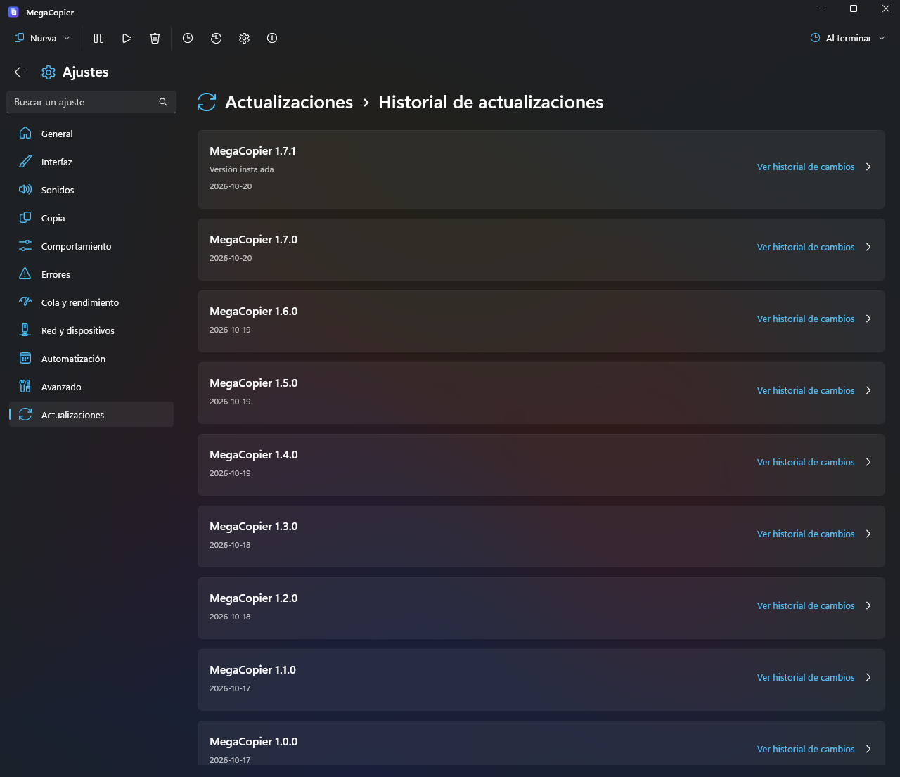

En modo **portátil** se descarga y verifica el ZIP, y el botón permite localizarlo en el Explorador. Cierra MegaCopier y sustituye los archivos de la aplicación conservando `Data` y `portable.txt`. Una copia de desarrollo no registrada como instalación también recibe el ZIP para evitar instalar accidentalmente sobre otra copia.

Cada descarga debe coincidir con el manifiesto firmado del editor y con SHA-256 antes de ejecutarse. Si falta la configuración de confianza o una verificación falla, se informa en esta sección y el paquete no se ejecuta. La firma del manifiesto no sustituye la firma de Windows del instalador. La comprobación de versiones consulta GitHub, que recibe los datos normales de una conexión HTTP, incluida la IP; no se envían registros ni nombres de archivos.

### Informes de errores

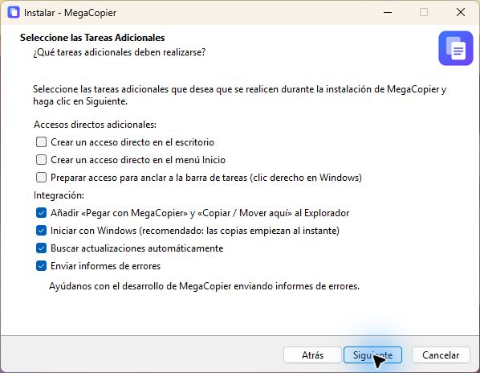

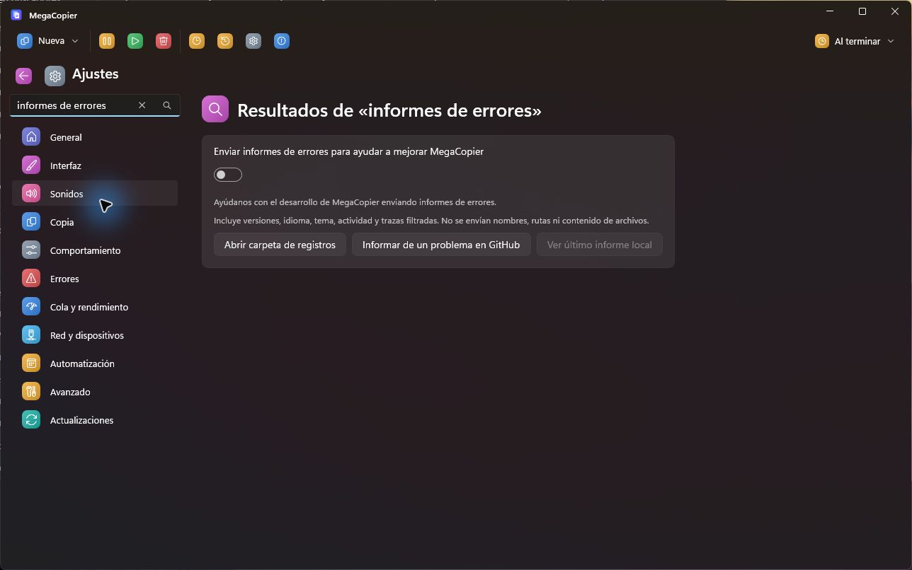

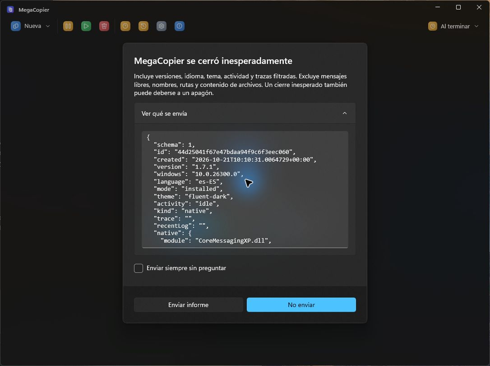

En *Ajustes > Avanzado > Informes de errores* puedes abrir la carpeta de registros, revisar el último informe filtrado
y abrir una incidencia pública de GitHub. Este último botón solo prepara la versión y Windows: no publica nada por sí
solo ni añade trazas o rutas. Revisa lo que escribas en GitHub porque esa incidencia será pública.

El registro `crash.log` ya existente permanece local y puede contener detalles personales. **No se adjunta sin filtrar.**
El informe conserva versiones, idioma, tema, modo instalado o portátil, actividad conocida y nombres de funciones y
códigos de error. Descarta mensajes libres de excepciones, parámetros, rutas, nombres de usuario/equipo y contenido de
archivos. De las últimas 50 líneas del registro solo conserva los datos que cumplen ese filtro. Esto reduce el detalle
disponible para diagnosticar fallos, pero evita enviar texto arbitrario del usuario.

Si queda una marca de sesión al arrancar, hubo un cierre inesperado: puede ser una caída, un cierre forzado o un apagón.
MegaCopier busca, cuando Windows lo permite y existe, el evento nativo 1000 de **su misma ruta, proceso y sesión** para
añadir módulo, código y desplazamiento. No inventa un fallo nativo si no encuentra ese evento. Los cierres normales,
incluidos los del instalador, eliminan la marca.

Una instalación nueva ofrece **Enviar informes de errores** marcado, junto a las tareas del instalador y con una
explicación debajo: «Ayúdanos con el desarrollo de MegaCopier enviando informes de errores». Puedes desmarcarlo antes de instalar. El asistente interactivo vuelve a ofrecerla marcada al reinstalar; puedes desmarcarla antes de continuar. Las actualizaciones silenciosas conservan la elección guardada. En modo portátil o sin una elección en el
instalador, el envío comienza desactivado. Con envío automático activo, los informes se envían en segundo plano sin
mostrar este diálogo. Mientras no se configure el servicio privado, los controles de envío no aparecen.
Con el servicio configurado y el envío automático desactivado, al volver de un cierre inesperado aparece una pregunta cuando no hay copias activas ni
otros diálogos: **Enviar**, **No enviar**, **Ver qué se envía** y **Enviar siempre sin preguntar**. La vista previa es el
JSON exacto que se enviaría. Puedes autorizar un informe sin activar los futuros. La opción de Ajustes solo autoriza
los futuros fallos y se puede desactivar; se cancela el envío en curso y se borran los pendientes locales, aunque no
se puede retirar lo que el servidor ya haya recibido.

Si no hay conexión, solo los informes autorizados quedan pendientes para el siguiente arranque. Hay un máximo de cinco
intentos diarios y veinte pendientes; los de más de catorce días se descartan al procesar la cola. El mismo fallo de la
misma versión no vuelve a enviarse durante noventa días. Cloudflare recibe la IP para limitar abusos; no se incluye en
el informe. El receptor comprueba que el destino de GitHub sea privado y agrupa fallos repetidos. Los datos ya recibidos
se conservan en ese repositorio hasta que el propietario los elimine conforme a su política de conservación.
La [guía del receptor](../tools/informes-worker/README.md) explica su configuración y los límites del plan gratuito.

**Desinstalar:** *Configuración > Aplicaciones > Aplicaciones instaladas > MegaCopier > Desinstalar*. No deja nada en el
registro. Al final pregunta si borrar también tus ajustes, temas e historial; por defecto se conservan por si lo vuelves a
instalar.

---

## 2. Copiar y pegar desde el Explorador

Una vez instalado, **no tienes que cambiar nada de lo que haces**:

- **Ctrl+C → Ctrl+V** en el Explorador o en el Escritorio: copia MegaCopier.
- **Pegar en la barra superior del Explorador**: usa MegaCopier y pega en la carpeta abierta de la pestaña activa;
  seleccionar una subcarpeta no cambia ese destino.
- **Ctrl+X → Ctrl+V**: mueve MegaCopier. En el mismo disco es un renombrado instantáneo (2 GB en 16 ms); entre discos se
  copia y el original solo se borra cuando su copia está completa y comprobada.
- **Clic derecho > Pegar** (la orden de Windows) también usa MegaCopier al abrir el menú sobre el fondo o una carpeta
  de la vista del Explorador o del Escritorio, incluido su menú clásico. Usa el ajuste de interceptar el pegado, igual que Ctrl+V. Si no puede reconocer la orden,
  el destino o confirmar el cierre del menú, conserva el pegado del Explorador. El menú clásico reconoce el atajo o
  la etiqueta localizada aprendida del menú moderno, al pasar por «Mostrar más opciones».
- **Clic derecho > Pegar con MegaCopier** en una carpeta o en el fondo de una ventana. En Windows 11 aparece en el menú
  corto, sin pasar por «Mostrar más opciones».
- **Arrastrar con el botón derecho** y soltar: «Copiar aquí con MegaCopier» o «Mover aquí con MegaCopier».
- **Arrastrar con el botón izquierdo** entre ventanas del Explorador, el Escritorio y las carpetas y unidades del panel
  de la izquierda (*Este equipo*, *Disco local (C:)*, *Descargas*…), con las mismas reglas de Windows (activado de
  serie y sin confirmación previa en instalaciones nuevas; en *Ajustes > General* puedes desactivarlo o hacer que pregunte antes, siempre o solo al mover). Soltar sobre
  un archivo o un ZIP sigue haciéndolo el Explorador.

La interceptación de Ctrl+V solo actúa cuando el foco está en la lista de archivos: nunca al escribir en la barra de
direcciones, en la búsqueda o al renombrar. **Mayús+Insertar** también pega archivos con MegaCopier. Al copiar y pegar
en el mismo sitio, crea duplicados con nombres nuevos; al cortar y pegar en el mismo sitio no mueve nada. «Pegar» en
la barra superior usa la pestaña visible, también en carpetas vacías recién activadas; los menús se pueden abrir con la tecla de menú o **Mayús+F10**.
Los menús sobre carpetas y unidades del panel lateral usan esa carpeta como destino. Las ubicaciones virtuales sin
carpeta de destino (*Este equipo* como fondo, el interior de un ZIP…) conservan el comportamiento del Explorador.

Al copiar un archivo individual de nuevo al mismo destino, con la regla **Preguntar**, se muestra el aviso aunque
parezca idéntico: **Reemplazar**, **Conservar ambos** u **Omitir**. No aparece «Uno a uno» ni «Hacer lo mismo con los demás»
para ese archivo único. Al reanudar un trabajo se siguen omitiendo los archivos que ya terminaron.

### Activar y desactivar

**Doble clic en el icono de MegaCopier de la bandeja** (junto al reloj). Desactivado, el icono se pone gris con una X roja
y copia el Explorador de Windows como siempre. Otro doble clic lo vuelve a activar. También está en el menú del icono:
*Desactivar (usar el copiador de Windows)* / *Activar MegaCopier*.

El menú del icono de la bandeja (clic derecho) tiene además: **Abrir MegaCopier**, **Pausar todo**, **Reanudar todo**,
**Bandeja de arrastre**, **Iniciar con Windows** y **Salir**.

Al minimizar u ocultar la ventana de copia, junto a él aparece **un icono por cada copia cuyo progreso no está visible** con su porcentaje y una barra que sube (ámbar en pausa,
rojo con errores); al terminar se llena, muestra una marca y se quita solo. Un clic abre esa copia y el clic derecho la
pausa, la reanuda o la detiene. Un clic recupera la copia elegida, también en la vista compacta y cuando cada copia tiene su propia ventana. MegaCopier solicita que sus iconos se muestren junto al reloj; Windows puede conservarlos en el área de ocultos. Si ocurre tras activar la función, cierra sesión y vuelve a entrar una vez para que Windows aplique la preferencia. También puedes arrastrar cada icono desde la flecha hacia el reloj o activarlo en la configuración de la barra de tareas de Windows.
Se apagan en *Ajustes > General > Progreso de cada copia en la bandeja*. Al volver a mostrar el progreso en su ventana, su icono individual desaparece.

En *Ajustes > General > Mostrar en la barra de tareas* puedes ocultar los botones de las ventanas en la barra de aplicaciones. Al desactivarlo, minimizar siempre oculta la ventana en la bandeja del sistema y el icono principal permanece disponible.

---

## 3. La ventana de copia

### Compacta

Al empezar una copia se abre la **ventana compacta**: la barra de arriba es el progreso total y la de abajo el del archivo
que se está copiando, con la velocidad y el tiempo que queda. Debajo, las unidades de origen y destino.

Los botones, siempre con su nombre:

- **⌄ Más**: amplía la ventana.
- **Pausar**: el mismo botón pasa a **Reanudar**. En una copia que espera turno porque otra usa el mismo disco, es
  **Comenzar**: la arranca a la vez que la otra.
- **Saltar**: deja el archivo actual y sigue con el siguiente; también en pausa: lo descarta y la copia sigue en pausa,
  lista para empezar el siguiente.
- **Detener**: cancela la copia y la quita de la lista; si era la única, la ventana se cierra sola. Lo que quedó a
  medias se borra o se guarda según *Ajustes > Comportamiento*: si se guarda, al volver a copiar lo mismo se sigue desde
  donde quedó.

Arriba está la **barra de herramientas** (*Nueva*, un solo botón para pausar o reanudar todas, historial, ajustes…), también en esta vista. Sus accesos se eligen y ordenan en *Ajustes > Interfaz > Barra de herramientas*; lo que no cabe pasa al menú **…** del final.
Al abrir **Ajustes** la ventana se agranda hasta el ancho de sus tarjetas y, al volver, recupera el tamaño que tenía. La entrada del menú lateral se reproduce solo al abrir Ajustes.

En modo automático, una nueva tanda empieza en la vista compacta aunque la anterior se ampliara al copiar varias cosas. **Más** abre los detalles y varias copias muestran la lista. **Recordar tamaño** conserva por separado el ancho compacto y las dimensiones de detalles y de la lista de copias; no guarda como elección del usuario las ampliaciones automáticas.

La **X** de la ventana cancela las copias, como *Detener* en cada una (MegaCopier sigue en la bandeja). En *Ajustes >
Interfaz* puedes hacer que las detenga para continuarlas después, que solo oculte la ventana o que salga de MegaCopier,
y que **minimizar** la esconda en la bandeja en lugar de la barra de tareas.

El botón **…** tiene más opciones de esa copia. Con varias copias aparece un paginador **‹ ›** para pasar de una a
otra. Esta ventana se puede ensanchar, pero no hacer más alta: no habría nada más que ver.

Se puede pulsar en casi todo:

- **El título** («Copiando «Juegos»»): abre la carpeta que se está copiando.
- **El archivo** en curso: lo muestra marcado en su carpeta.
- **El origen** (la unidad y la ruta de la izquierda): muestra lo que se copia, marcado en la carpeta donde está.
- **El destino**: muestra la copia ya en el destino, marcada.

Si una pregunta (por ejemplo, «la carpeta ya existe») llega con la ventana pequeña, aparece **dentro de ella**, en el
sitio del progreso: las opciones en una fila, con la explicación de cada una al pasar el ratón.

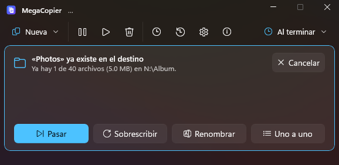

Cuando todo termina bien, la ventana se cierra sola (*Ajustes > Interfaz > Al terminar las copias*).

### Completa

**«Más»** la convierte en la **vista completa**:

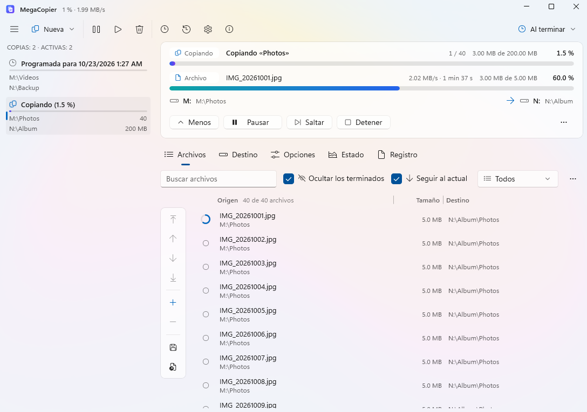

- **Barra de herramientas:** menú lateral, **Nueva** (todas las operaciones, ver [el menú «Nueva»](#6-el-menú-nueva)),
  pausar todas, reanudar todas, quitar las terminadas, **línea de tiempo**, **historial**, **ajustes**, **acerca de** y
  **Al terminar** (qué hace el equipo cuando acaban todas las copias: nada, suspender, hibernar, apagar, cerrar sesión o
  cerrar MegaCopier).
- **A la izquierda**, todas las copias: arriba lo que hace («Copiando (29,7 %)», o cuándo terminó) y debajo el origen y
  el destino, con los archivos y el tamaño. Se reordenan arrastrándolas. Las terminadas siguen a la vista mientras
  quede alguna activa; al acabar todas pasan al historial. Con el clic derecho (o **Supr**) se archivan en el historial
  o se eliminan. El botón de las tres rayas abre y cierra la lista; cerrada, lleva en rojo cuántas copias siguen
  activas.
- **A la derecha**, la copia elegida con cinco pestañas:

| Pestaña | Qué tiene |
|---|---|
| **Archivos** | La lista viva de archivos con su origen, su tamaño y su destino. Botones para llevar al principio, subir, bajar, llevar al final, añadir, quitar, guardar y cargar la lista (ver más abajo). Buscar, filtrar por estado, *Ocultar los terminados*, *Seguir al actual*, las sumas de origen y destino (menú «⋯») y exportar a CSV o HTML. |
| **Destino** | El espacio libre de cada unidad de destino. |
| **Opciones** | El **límite de velocidad** de esa copia (ver más abajo). Qué se copia (fechas, atributos, ADS, permisos, propietario, auditoría), el modo, qué hacer si el archivo existe, el algoritmo de suma, el búfer, la verificación, archivo de sumas, informe HTML, comandos al terminar, filtros y reglas. Se pueden cambiar con la copia en marcha. |
| **Estado** | Gráfica de velocidad y totales: copiados, verificados, omitidos, con errores y pendientes. |
| **Registro** | Todo lo que ha pasado, con la hora. |

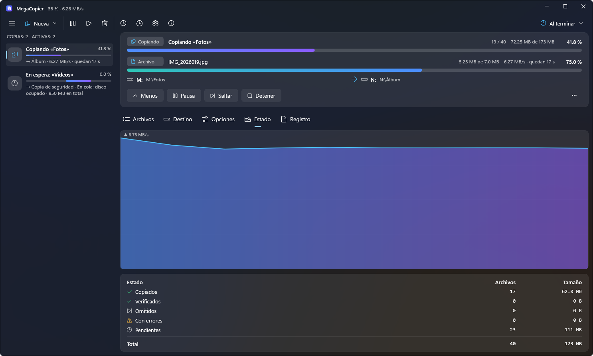

En *Ajustes > Interfaz > Ventana de copia* eliges si empieza **compacta**, **completa** o **automática** (compacta con
una copia y completa cuando hay varias a la vez). Son tres vistas: la **pequeña**, la de **la lista** («Más», con un
tamaño mínimo para que todo quepa y que se puede maximizar) y la de **varias copias**, que es la misma con la lista de
copias a la izquierda (solo aparece cuando hay más de una).

### Una copia nueva mientras otra está en marcha

Si la copia nueva va **al mismo disco** que una que ya está copiando, MegaCopier sale al frente y pregunta:

- **Añadir a esta copia**: sus archivos se copian al final de la lista de la que está en marcha (cada cosa a su
  carpeta), con una sola barra. Antes comprueba que haya espacio.
- **Copia aparte**: otra copia que espera a que termine la primera (dos copias a la vez al mismo disco van más lentas);
  **Comenzar** la arranca ya.
- **Cancelar**: no copia nada de lo nuevo.

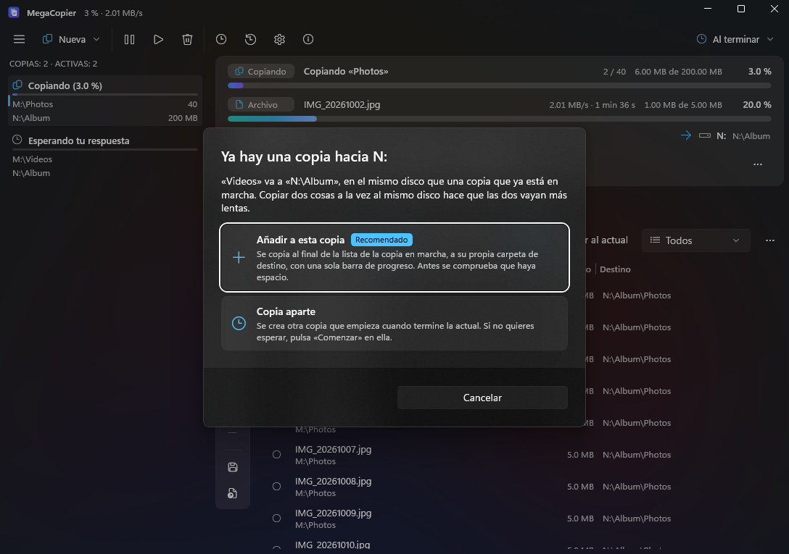

Si va **a otro disco**, empieza a la vez, sin esperar: cada disco copia a su velocidad. Las dos cosas se cambian en
*Ajustes > Comportamiento*.

Si prefieres **una ventana por copia**, activa *Cada copia en su propia ventana* (también en *Comportamiento*): cada
copia abre su ventana y empieza ya. Es la misma aplicación (mismo tema, mismos iconos y ajustes en todas) y cada ventana
tiene su icono de progreso en la bandeja. Si la nueva va al mismo disco que otra, la pregunta ofrece añadirla a la copia
de esa ventana o abrirla **en una ventana nueva**.

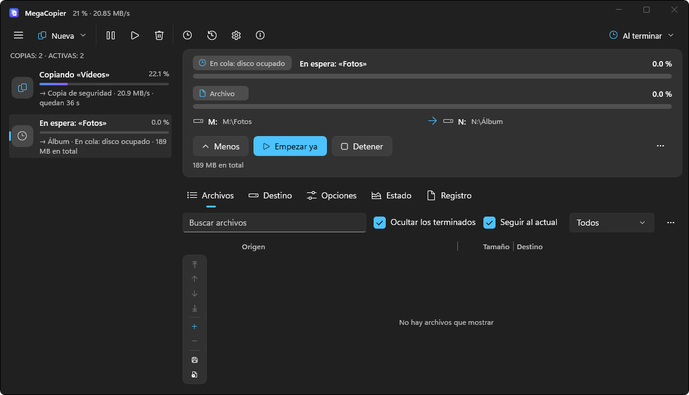

En la lista, la búsqueda va siempre a la izquierda y encoge si falta sitio; las casillas *Ocultar los terminados* y
*Seguir al actual* van a su lado. Los botones de la izquierda empiezan a la altura del primer archivo y se ven siempre
todos: si la lista es baja, se hacen algo más pequeños. Al subir o bajar archivos con ellos, siguen elegidos. Entre
*Origen*, *Tamaño* y *Destino* hay **líneas divisorias**: se arrastran para dar a cada columna el ancho que quieras (se
recuerda) y con doble clic vuelven al de siempre. El archivo que se está copiando lleva un **círculo que se va
llenando** con su progreso y se cierra al terminarlo.

### La lista de archivos

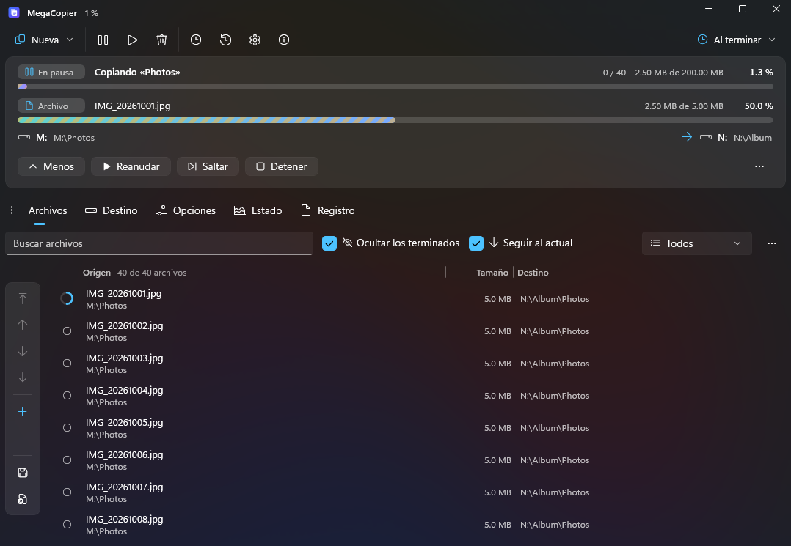

- **Elegir varios**: clic, Ctrl+clic para sumar uno y Mayús+clic para un tramo seguido.
- **Botones de la izquierda** (también en el menú del botón derecho):
  - **Al principio** (Alt+Inicio) y **Al final** (Alt+Fin): los elegidos se copian los siguientes o los últimos.
  - **Subir** (Alt+↑) y **Bajar** (Alt+↓): una posición.
  - **Añadir** archivos o carpetas a la misma copia: van al final de la lista y al mismo destino.
  - **Quitar** (Supr): deja de copiarlos; no se borra nada.
  - **Guardar la lista**: guarda lo que falta por copiar, con su destino y sus opciones, para seguir más tarde aunque
    apagues el equipo.
  - **Cargar una lista**: empieza a copiar en seguida lo que faltaba, al mismo destino. Si ese destino ya no está (una
    memoria USB que quitaste), MegaCopier lo avisa y te deja elegir otro sitio para el resto.
- **Arrastrar**: los archivos pendientes se reordenan arrastrándolos. Si arrastras archivos del Explorador **sobre la
  lista**, una línea marca dónde entrarán; si los sueltas **en cualquier otra parte de la copia** (el panel, las pestañas),
  se añaden al final.

### Límite de velocidad de cada copia

En la pestaña **Opciones** de una copia, el interruptor **Límite de velocidad de esta copia** y su deslizador (de 256 KB/s
a 1 GB/s) frenan esa copia **al momento**, sin pararla. Sirve para que una copia grande no se coma la red o el disco
mientras trabajas. El límite general de *Ajustes > Copia > Rendimiento* se aplica a las copias nuevas y a las que están en
marcha con él.

### Al terminar

Según *Ajustes > Interfaz > Al terminar las copias*, la ventana se **cierra si todo fue bien** (lo normal), se **cierra
siempre** o **se queda abierta**. Si se queda abierta verás el resumen y el botón **Abrir carpeta**:

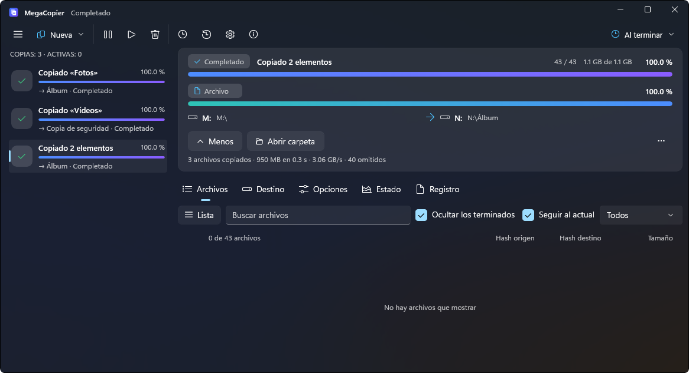

También puedes arrastrar archivos o carpetas a la ventana para copiarlos.

---

## 4. Si se va la luz: reanudar

Es lo que hace a MegaCopier diferente. Si la copia se corta (apagón, cuelgue, Windows se reinicia, se desconecta el USB),
**no se pierde lo copiado**:

1. Al volver a abrir MegaCopier, la copia aparece como **«Interrumpido · se puede continuar desde donde quedó»** y Windows
   muestra un aviso.

   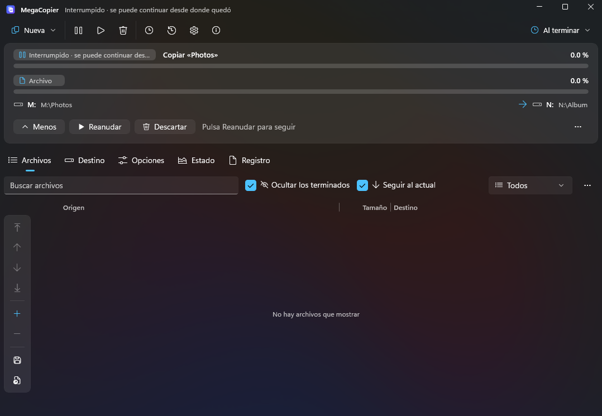

2. Pulsa **Continuar** (▶). MegaCopier comprueba que lo ya copiado está bien y sigue **dentro del mismo archivo**, no
   desde el principio. Vuelve a escribir enseguida: si verificas o guardas sumas, la suma del archivo entero se calcula
   a la vez que se copia el resto:

   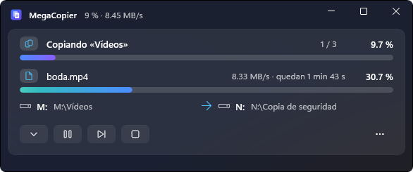

Si prefieres que sigan solas sin preguntar: *Ajustes > Copia > Reanudar solas al arrancar*. Con **Descartar** (la
papelera) se abandona la copia y se borra lo que quedó a medias.

Mientras copia, el equipo no se suspende. Si el disco o la red desaparecen un momento, MegaCopier **espera** a que
vuelvan (y también a que haya espacio libre) en vez de fallar.

Antes de empezar, MegaCopier comprueba que lo que vas a copiar **cabe** en el destino (y lo mismo al añadir archivos a
una copia en marcha). Si no cabe, dice cuánto hace falta y cuánto hay libre: **Cancelar** no copia nada; **Forzar la
copia** copia hasta llenar el disco y espera a que liberes espacio para seguir sola. Si cierras MegaCopier con una copia
en marcha y luego vuelves a copiar lo mismo, se continúa esa copia en lugar de empezar otra.

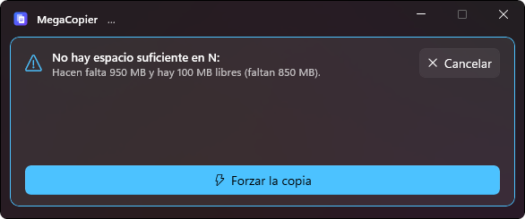

---

## 5. Si el archivo ya existe

Por defecto MegaCopier **pregunta**, enseñando los dos archivos con su miniatura, tamaño y fecha (y cuál es más reciente):

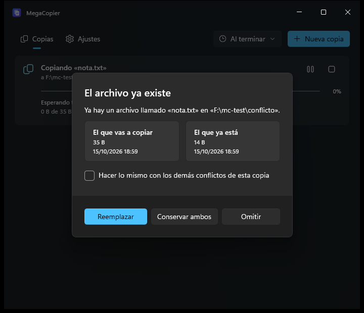

- **Reemplazar**, **Conservar ambos** (el nuevo se copia con otro nombre) u **Omitir**.
- **Renombrar el que ya está y copiar este**.
- **Hacer lo mismo con los demás conflictos de esta copia**, para no tener que contestar uno a uno.

Si no quieres que pregunte, elige una regla fija en *Ajustes > Copia > Si el archivo ya existe*: reemplazar, omitir,
reemplazar si es más nuevo, reemplazar si cambia el tamaño, conservar ambos o renombrar el que ya está. El patrón de
nombres se puede cambiar (`{name} ({n}){ext}`, `{date}`…).

Si el archivo de destino es idéntico al de origen, se omite sin preguntar.

### Si la carpeta ya existe

Si copias una carpeta que ya está en el destino con algunos de sus archivos, MegaCopier pregunta **una vez, antes de
empezar**:

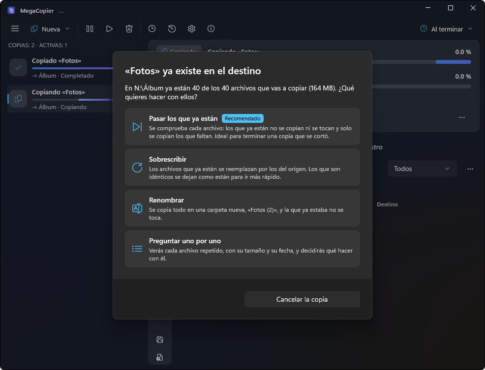

- **Pasar los que ya están** (recomendado): comprueba cada archivo; los que ya están no se copian ni se tocan y se copian
  solo los que faltan. Ideal para terminar una copia que se cortó.
- **Sobrescribir**: los que ya están se reemplazan, también los que parecen iguales: todo se vuelve a copiar.
- **Renombrar**: se copia todo en una carpeta nueva, «Fotos (2)», y la que ya estaba no se toca.
- **Preguntar uno por uno**: el diálogo de arriba, archivo por archivo.

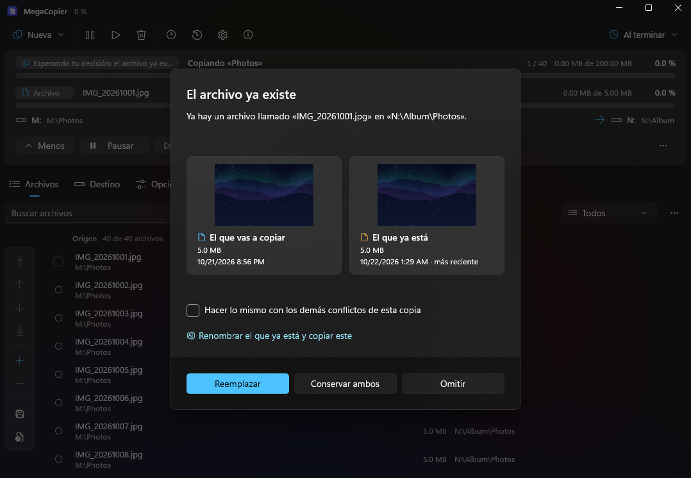
- **Cancelar la copia**: no se copia nada.

Se cambia en *Ajustes > Copia > Reglas > Si una carpeta ya existe en el destino* (combinar su contenido, omitirla entera o
preguntar).

---

## 6. El menú «Nueva»

El botón **Nueva** de la vista completa reúne todo lo que MegaCopier sabe hacer sin pasar por el Explorador:

| Opción | Qué hace |
|---|---|
| **Copiar… / Mover…** | Eliges qué (archivos o carpetas, ver abajo) y adónde. |
| **Copiar a** | Copia rápida a un favorito, un destino reciente o una carpeta abierta en el Explorador, Total Commander o Directory Opus. |
| **Cargar una lista de copia…** | Repite una lista de archivos guardada. |
| **Enviar a otro equipo…** | Por la red local a otro PC con MegaCopier o a un móvil con LocalSend. |
| **Móviles, cámaras y servidores** | Copiar desde o hacia un móvil, una cámara o un servidor: MTP, FTP, SFTP, WebDAV, S3 y nubes. |
| **Comparar y sincronizar carpetas…** | Ver [Sincronizar](#9-sincronizar-carpetas). |
| **Comprobar y reparar** | Comprobar con archivos de sumas (`.sha256`, `.md5`, `.sfv`, `.b3`, `.xxh3`… o carpetas que los tengan, ver [Comprobar](#8-comprobar-que-la-copia-está-bien)), crear un archivo de sumas y reparar con datos de recuperación (ver [Proteger](#11-proteger-tus-copias)). |
| **Copias de seguridad** | Copia sin duplicados, restaurar y descifrar archivos cifrados (ver [Copias de seguridad](#10-copias-de-seguridad-y-versiones)). |
| **Borrar… / Borrar de forma segura…** | Archivos o carpetas, siempre con confirmación. |
| **Bandeja de arrastre** | Una ventanita donde vas soltando archivos de distintas carpetas para copiarlos juntos después. |

**Un solo selector para archivos y carpetas.** Es el diálogo «Abrir» de Windows con un botón más, **«Seleccionar»**:
marca una carpeta y pulsa «Seleccionar» para elegirla entera; entra en ella y marca algunos archivos para elegir solo
esos; sin nada marcado, elige la carpeta que estás viendo. «Abrir» sigue entrando en las carpetas como siempre.

---

## 7. Varios destinos, favoritos y programar

Al elegir el destino (por ejemplo, con *Copiar archivos…*) se abre la ventana de destinos, donde puedes:

- **Añadir varios destinos**: la misma copia va a la vez a dos discos o a un disco y un NAS. Se lee el origen una sola vez.
- Usar **favoritos** (la estrella de cada carpeta la añade o la quita; también en *Ajustes > Red y dispositivos > Carpetas favoritas*), **recientes** o las **carpetas abiertas** en el
  Explorador, Total Commander y Directory Opus.
- **Mover** en vez de copiar, **simular** (dice qué haría sin cambiar nada) y elegir el **modo**:
  - **Copiar** (normal).
  - **Sincronizar (espejo)**: deja el destino igual que el origen, quitando lo que sobra.
  - **Solo actualizar los que ya existen**.
  - **Solo la estructura de carpetas**, sin archivos.
  - **Organizar fotos por fecha**: fotos y vídeos en carpetas año-mes según la fecha en que se tomaron.
- **Cifrar** con contraseña o copiar a un **ZIP** o **7z** (ver [Cifrar](#12-cifrar-comprimir-y-borrar-de-forma-segura)).
- **Programar** la hora de inicio (sigue programada aunque reinicies el equipo) o guardarla como **tarea** que se repite.

### Filtros

En la pestaña **Opciones > Filtros** de cada copia (o con `mcopy`):

- Incluir y excluir por nombre (`*.jpg; node_modules`), tamaño, fechas, ocultos y de sistema.
- **En lenguaje normal**: escribe «fotos de más de 2 MB del último mes sin los .tmp» y MegaCopier lo convierte en filtros.
- **Por el texto de las fotos y capturas**: «con el texto "factura"» busca dentro de las imágenes con el reconocimiento de
  texto de Windows, sin internet.
- **Omitir fotos duplicadas**: no copia lo que ya está en el destino aunque tenga otro nombre.
- Omitir basura: `Thumbs.db`, `desktop.ini`, `.DS_Store`, `~$…`.

---

## 8. Comprobar que la copia está bien

- **Verificar después de copiar** (*Ajustes > Copia*, o en cada copia): relee el destino **sin caché** (de verdad del
  disco), compara las sumas con el origen y, si un bloque no coincide, **lo vuelve a copiar**.
- **Algoritmo de suma**: CRC32, xxHash3, xxHash64, xxHash128, MD5, SHA-1, SHA-256, SHA-512, SHA3-256, SHA3-512 o BLAKE3.
  xxHash3 es el más rápido; SHA-256 y BLAKE3 sirven además como prueba de que nadie ha tocado los archivos.
- **Guardar archivo de sumas** al terminar, para comprobarlo cuando quieras.
- **Comprobar sumas** (*Nueva > Comprobar…*): lee un `.sha256`, `.sha1`, `.sha512`, `.md5`, `.sfv`, `.b3` o `.xxh*`
  (formatos sha256sum, BSD y xxhsum) y dice qué está bien, qué ha cambiado y qué falta.

Los errores se explican en lenguaje claro («otro programa tiene el archivo abierto», «no queda espacio»…) con un botón
**Reintentar**; el detalle técnico está en el texto que aparece al pasar el ratón.

---

## 9. Sincronizar carpetas

### Comparar y sincronizar

*Nueva > Comparar y sincronizar carpetas…*: eliges una carpeta a la izquierda y otra a la derecha y pulsas **Comparar**.

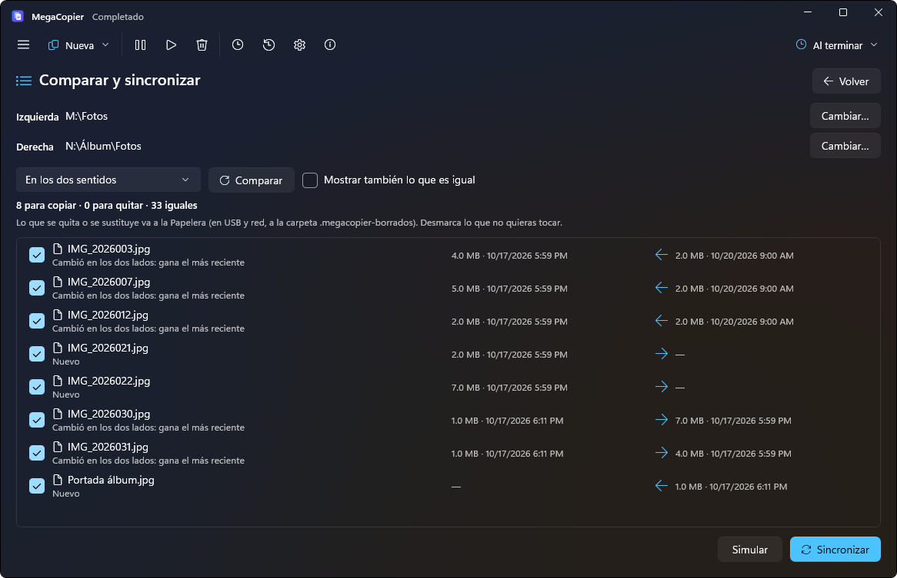

- Ves cada diferencia: archivos nuevos, cambiados, borrados, con su tamaño y fecha en cada lado y una flecha con lo que
  se hará.
- Eliges el sentido: **en los dos sentidos**, **de izquierda a derecha** o **de derecha a izquierda**.
- Desmarca lo que no quieras tocar. **Simular** enseña el resultado sin cambiar nada; **Sincronizar** lo hace.

En los dos sentidos, MegaCopier **recuerda cómo estaban** las carpetas la última vez: así sabe si un archivo se borró en un
lado (y lo borra en el otro) o es nuevo, y **detecta los renombrados y movidos** (los renombra en el otro lado en vez de
copiarlos otra vez). Lo que se quita o se sustituye va a la **Papelera** (en USB y red, a la carpeta
`.megacopier-borrados`).

### Espejo

El modo **Sincronizar (espejo)** deja el destino exactamente igual que el origen. Es en un solo sentido: lo que se borre en
el origen se borra en el destino (con la carpeta de versiones, se guarda allí en vez de perderse).

### Sincronización en tiempo real

*Ajustes > Automatización > Añadir carpeta…*: MegaCopier vigila la carpeta y copia cada cambio al momento
a su destino, mientras esté abierto en la bandeja. Puede ser en espejo (también borra) o solo añadir y actualizar.

---

## 10. Copias de seguridad y versiones

### Copias de seguridad sin duplicados

*Nueva > Copia de seguridad sin duplicados…* (o `mcopy backup`). Cada copia de seguridad es una **instantánea** completa,
pero los datos se guardan troceados por contenido: lo que no ha cambiado no se vuelve a guardar. Diez copias de algo que
apenas cambia ocupan poco más que una.

Para recuperar: *Nueva > Restaurar una copia de seguridad…*, eliges la fecha y adónde (o `mcopy snapshots` y
`mcopy restore`).

### Carpeta de versiones

Al copiar o sincronizar, lo que se sobrescribe o se quita puede guardarse en una **carpeta de versiones** dentro del
destino, en vez de perderse. Con **limpieza automática** (por ejemplo: una versión por día de la última semana, una por
semana del último mes y una por mes del último año).

### Copia delta

Al reemplazar archivos grandes (máquinas virtuales, bases de datos…), solo se escriben los **bloques que cambiaron**. Mucho
más rápido, y se puede deshacer desde el historial.

---

## 11. Proteger tus copias

- **Escudo contra ransomware** (activado siempre): si muchos archivos que van a sobrescribir una copia buena parecen
  cifrados de repente, la copia **se para** antes de estropear también la copia buena, y te avisa.
- **Datos de recuperación** (`--recovery`): guarda junto a la copia un pequeño porcentaje de datos extra (paridad
  Reed-Solomon, como PAR2). Si con los años el disco o el USB estropea bloques de la copia, *Nueva > Reparar con datos de
  recuperación…* (o `mcopy repair`) los reconstruye **sin necesitar el original**.
- **Guardián de integridad** (*Ajustes > Automatización > Guardián de integridad*): guarda la suma de cada archivo de las carpetas que
  elijas y las revisa cada día, semana o mes. Si un archivo se ha dañado sin que nadie lo tocara (corrupción silenciosa
  del disco), te avisa.
- **Aviso SMART** (*Ajustes > Avanzado > Estado de los discos*): avisa cuando un disco empieza a fallar.
- **Modo forense** (`--forensic`): guarda un manifiesto con la SHA-256 de cada archivo de origen y de destino, quién copió
  y cuándo, firmado digitalmente. Cualquiera puede comprobar después que nada ha cambiado con `mcopy verify-manifest`.
- **Modo rescate** (`--rescue`): para discos dañados; salva todo lo legible y deja en ceros lo que no se puede leer, en vez
  de fallar.
- **Carpetas «todo o nada»** (`--atomic`): la carpeta solo aparece en el destino cuando está completa.

---

## 12. Cifrar, comprimir y borrar de forma segura

- **Copia cifrada**: en la ventana de destinos, *Cifrar* y una contraseña. Cada archivo se guarda cifrado con AES-256
  (`.mcenc`). Para recuperarlos: *Nueva > Descifrar archivos cifrados…* o `mcopy decrypt`. **Si olvidas la contraseña no
  hay forma de recuperarlos.**
- **A ZIP** (con o sin contraseña): el ZIP cifrado usa AES de WinZip y lo abren 7-Zip, WinRAR y WinZip.
- **A 7z** (con o sin contraseña): cifrado, oculta también los nombres de los archivos.
- ZIP y 7z se comprimen **en paralelo** en varios núcleos.
- **Borrar de forma segura** (*Nueva > Borrar de forma segura…*): sobrescribe antes de borrar, con una pasada de ceros,
  una aleatoria, DoD de 3 pasadas o DoD de 7 pasadas. Los enlaces se borran como enlaces, sin tocar lo que hay detrás.

---

## 13. Móviles, otros equipos, servidores y nubes

### Móviles y cámaras por USB

Conecta el móvil o la cámara (en el móvil, elige *Transferir archivos*). *Nueva > Copiar desde un móvil, cámara o
servidor…* para traer fotos, o *Copiar archivos a un móvil, cámara o servidor…* para llevar.

### LocalSend (iPhone y Android, sin cables)

[LocalSend](https://localsend.org) es una app gratuita para el móvil. Con *Ajustes > Red y dispositivos > Recibir
desde el móvil con LocalSend* activado, el PC aparece en LocalSend y lo que envíes llega a la carpeta que elijas. Para
**enviar al móvil**: *Nueva > Enviar archivos a otro equipo…* y elige el móvil.

### Otro PC con MegaCopier

En el PC que recibe: *Ajustes > Red y dispositivos > Recibir archivos de otros equipos con MegaCopier*. Te da un
**código**. En el que envía: *Nueva > Enviar archivos a otro equipo…*, elige el equipo (o escribe su nombre o IP) y el
código. Va cifrado y por la red local.

### Servidores

*Ajustes > Red y dispositivos > Añadir…*: **FTP**, **FTPS**, **SFTP**, **WebDAV** (Nextcloud, ownCloud, NAS…) y **S3**
y compatibles (AWS, Backblaze B2, Cloudflare R2, Wasabi, MinIO). Después aparecen como origen y destino. Las contraseñas
se guardan en el Administrador de credenciales de Windows, nunca en archivos.

MegaCopier usa varias conexiones a la vez (hasta 255) y **las ajusta solo** según la velocidad que consigue. El máximo se
elige en *Conexiones a la vez (máximo)*.

### Nubes: OneDrive, Google Drive y Dropbox

Se añaden igual que un servidor, con inicio de sesión en el navegador (MegaCopier nunca ve tu contraseña). Cada servicio
pide **registrar la app una vez** (gratis, unos 10 minutos): [cómo conectar las nubes](Nube.md).

### Total Commander y Directory Opus

Un botón que llame a `mcopy send` hace que copien con MegaCopier: [Integraciones](Integraciones.md).

---

## 14. La cola, la línea de tiempo y el historial

- **Cola por disco**: dos copias en el mismo disco van **de una en una** (a la vez serían más lentas); en discos distintos
  van **a la vez**. *Ajustes > Cola y rendimiento* fija el máximo de copias a la vez y qué discos son «rápidos» (pueden con varias).
- **Línea de tiempo** (icono del reloj): cuándo empezará y terminará cada copia, según la velocidad de cada disco.

  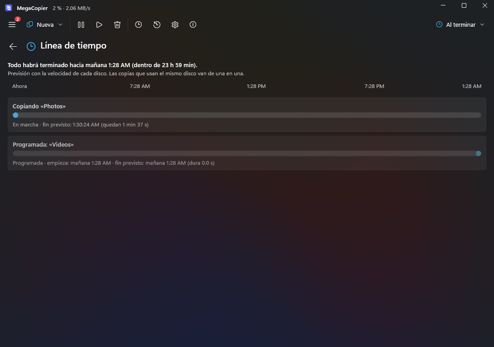

- **Historial** (icono del reloj con flecha): todas las copias terminadas, con **Repetir**, **Deshacer** (quita lo
  copiado o devuelve lo movido), **Copiar de vuelta** y **Abrir destino**.

  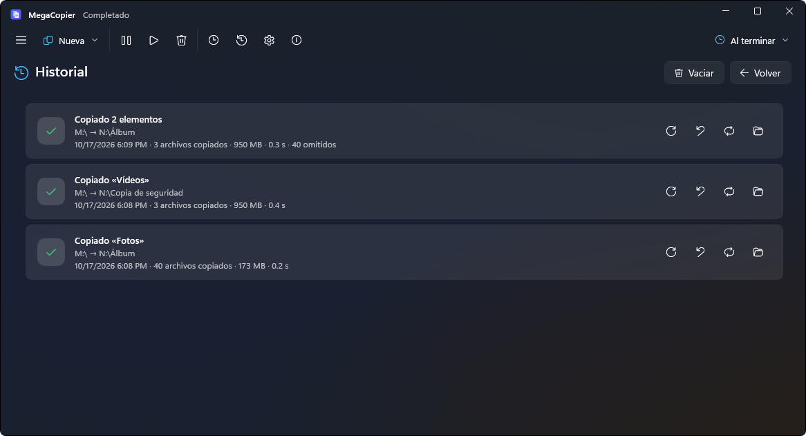

---

## 15. Tareas programadas y avisos

- **Tareas programadas**: en la ventana de destinos, *Guardar como tarea*. Se repiten una vez, cada día, semana o mes.
  Si el PC estaba apagado a esa hora, **se hacen al encenderlo**. Se gestionan en *Ajustes > Automatización > Tareas programadas*.
- **Avisar al terminar** con una notificación de Windows y sonido (*Ajustes > Sonidos*).
- **Avisar por correo** (*Ajustes > Automatización*): servidor SMTP, remitente y destinatarios, o solo si hay problemas. Tiene
  botón de prueba.
- **Avisar a una dirección web** (webhook) al terminar, para Slack, Discord, Teams, Home Assistant o lo que uses.
- **Al terminar** (barra de herramientas): suspender, hibernar, apagar, cerrar sesión o cerrar MegaCopier.
- **Comandos al terminar** (pestaña Opciones): uno por línea, se ejecutan con `cmd.exe` y reciben variables como
  `%MEGACOPIER_STATE%` o `%MEGACOPIER_DESTINATION%`. Empieza la línea con `ok:` para que solo se ejecute si todo fue bien,
  o con `error:` si falló.

---

## 16. Controlar desde el móvil y con asistentes de IA

- **Controlar desde el móvil** (*Ajustes > Red y dispositivos > Controlar desde el móvil*): abre en el navegador del
  móvil la dirección que te da, escribe el código y verás las copias con su progreso, y podrás pausarlas, seguirlas o
  detenerlas. Solo funciona en tu red local y se bloquea tras 10 códigos erróneos.
- **Asistentes de IA** (Claude, Copilot y otros): `mcopy mcp` es un servidor MCP. El asistente puede pedir copias,
  comprobaciones y copias de seguridad («copia Documentos al NAS esta noche y verifícala»). No puede borrar nada.
  [Cómo configurarlo](Integraciones.md#asistentes-de-ia-claude-copilot-y-otros-servidor-mcp).

---

## 17. Ajustes

Botón del engranaje en la vista completa. Están organizados **como la Configuración de Windows 11**: las secciones a la
izquierda, cada una con su icono, y sus opciones a la derecha, cada una con su icono y su explicación debajo. Arriba a la
izquierda hay un **buscador**: escribe, por ejemplo, «sonido» o «USB» y aparecen solo los ajustes que lo mencionan, de
cualquier sección. Al cambiar de sección el contenido entra deslizándose y, al pulsar una opción, su icono da un salto.
En una ventana estrecha la lista de secciones se queda solo con los iconos.

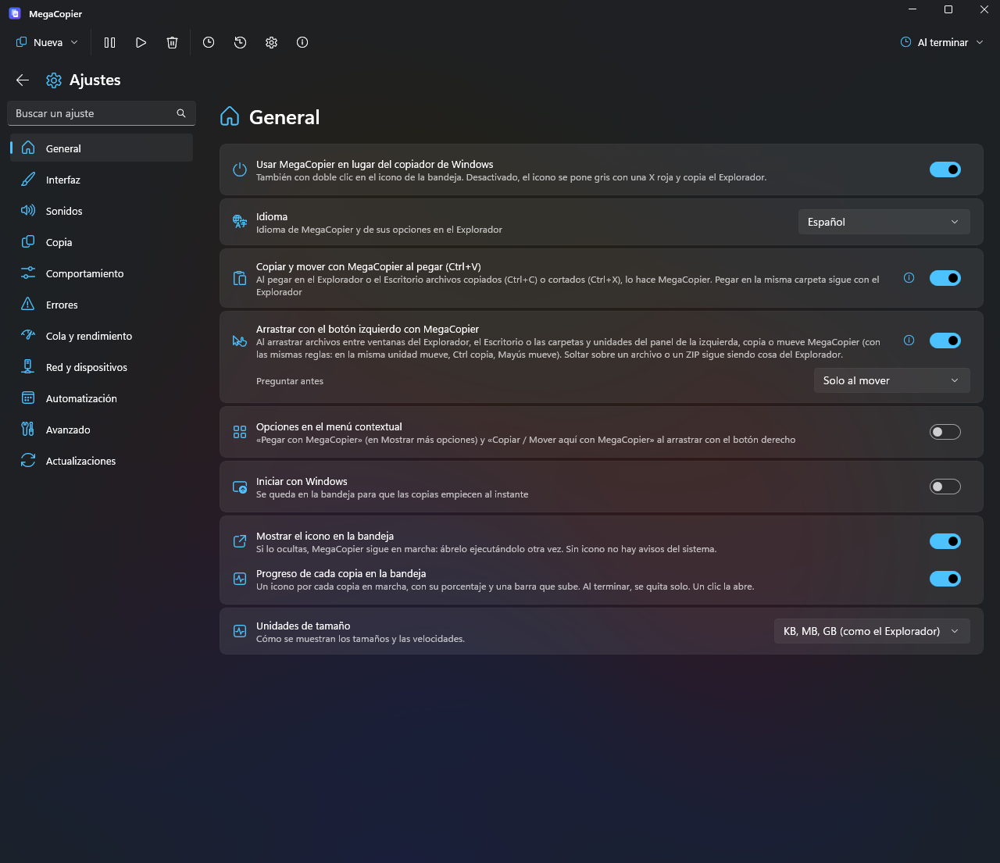

| Sección | Qué se ajusta |
|---|---|
| **General** | Usar MegaCopier en lugar del copiador de Windows · Copiar y mover al pegar (Ctrl+V) · Arrastrar con el botón izquierdo (y si preguntar antes) · Opciones en el menú contextual · Iniciar con Windows · **Idioma** · Unidades de tamaño · Mostrar el icono en la bandeja · **Progreso de cada copia en la bandeja**. |
| **Interfaz** | Ventana compacta, completa o automática · Qué hacer al terminar · **Qué hacen la X y Minimizar (cada una por separado)** · Siempre visible · **Barra de herramientas** (qué accesos se ven y en qué orden) · Avisar al terminar · Iniciar las copias con la ventana minimizada · Recordar la posición y el tamaño de la ventana · **Fondo de la ventana** (el del tema, Mica, Mica Alt, Acrílico o Translúcida; al usar otra ventana cada uno pasa a su pareja: Mica ⇄ Mica Alt y Acrílico ⇄ Translúcida) · Ajustar a pantallas pequeñas · **Temas** y su editor · **Conjuntos de iconos** (ver [Temas e iconos](#18-temas-e-iconos)). |
| **Sonidos** | Cuatro tarjetas: avisos con sonido, volumen en una línea con su porcentaje, personalización de sonidos y silencio durante juegos, presentaciones o «No molestar», con interruptor activado por defecto. Sonido para cada momento (copia terminada, todas terminadas, error, pregunta), volumen y no sonar con juegos, presentaciones o «No molestar». Por defecto suenan los **sonidos propios de MegaCopier** (campanillas originales, no los avisos de Windows); en cada momento puedes elegir, de arriba abajo, **un archivo tuyo**, ninguno, el propio de ese momento, uno de la **colección de MegaCopier** (19 sonidos originales: avisos de menos de un segundo, notificaciones de 1,5 a 3 s y melodías de hasta 4 s) o uno de Windows, y probarlo con ▶. |
| **Copia** | Verificar después de copiar · Si el archivo ya existe · Algoritmo de suma · Qué se copia (fechas, atributos, ADS, permisos, propietario, auditoría) · Archivo de sumas e informe · Comprobar el espacio libre antes · Caché del sistema · Comprimir por la red (SMB) · Reanudar solas al arrancar · Rendimiento · Filtros y reglas. |
| **Comportamiento** | **Copia nueva al mismo disco que otra en marcha** (preguntar, añadirla, copia aparte después o a la vez) · **Copia nueva a otro disco** (empezar a la vez o esperar su turno) · **Cada copia en su propia ventana** (una ventana por copia, que empieza ya) · **Al mover, conservar también** atributos, permisos, propietario y auditoría · **Al detener una copia, borrar lo que quedó a medias** (y no hacerlo si paró por un error) · **Al terminar, expulsar la unidad de destino** si es extraíble (y forzarlo). |
| **Errores** | **Si un archivo sigue fallando**: omitirlo y seguir, detener la copia, reintentarlo al final o **preguntar qué hacer** · Reintentos y espera entre ellos · **Informe de errores** automático (en la carpeta de destino o en una fija, con el nombre que quieras) · Guardar el registro de cada copia. |
| **Cola y rendimiento** | Copias a la vez · Dispositivos rápidos · Ir más despacio mientras usas el equipo · Límite de velocidad por horario · Pausar con batería · Pausar en juegos · Prioridad del proceso · Excluir MegaCopier de Windows Defender · Ajuste automático para cada disco. |
| **Red y dispositivos** | Carpetas favoritas · Recibir de otro PC con MegaCopier · Recibir con LocalSend · Controlar desde el móvil · Servidores y nubes. |
| **Automatización** | Sincronización en tiempo real · Tareas programadas · Guardián de integridad · Comandos al terminar · Avisos por webhook y por correo. |
| **Avanzado** | Estado de los discos (SMART) · Carpeta de datos (dónde guarda MegaCopier sus ajustes) · **Restablecer los ajustes** de fábrica. |

### Si un archivo sigue fallando: preguntar

Con *Errores > Si un archivo sigue fallando > Preguntar qué hacer*, cuando un archivo no se puede copiar (por ejemplo,
porque otro programa lo tiene abierto) la copia se para y pregunta, explicando el motivo:

- **Reintentar**: cierra el programa que lo usa y pulsa; sigue desde el journal.
- **Omitir**: lo deja apuntado como fallido y sigue con el siguiente. Con *Omitir también los siguientes errores de esta
  copia* ya no vuelve a preguntar.
- **Detener la copia**: se para y se puede continuar más tarde.

Cambiar el **idioma** pide reiniciar MegaCopier (la app lo ofrece con un botón). Hay 14: español, inglés, francés, alemán,
italiano, portugués de Brasil, ruso, ucraniano, polaco, neerlandés, turco, chino, japonés y coreano.

---

## 18. Temas, iconos y barras de progreso

*Ajustes > Interfaz > Temas*. **73 temas** que cambian toda la interfaz al momento, también los botones, las listas, los
menús, los cuadros de texto, los interruptores y hasta las barras de desplazamiento. Todos están diseñados para Windows 11, con
degradados, y algunos tienen **textura** de fondo:

| Oscuros | Claros |
|---|---|
| Fluent oscuro · Medianoche · Grafito · Océano · Bosque · Atardecer · Alto contraste · **Combustión** (brasas) · **Caja negra** (fibra de carbono) · Metro oscuro · Robot verde · Cielo de otoño · Ámbar · Granate · **Código verde** (lluvia digital) · Vapor · Metro gris · Televisión · Reproductor · Humo · Berenjena · Cobalto · Esmeralda · Mandarina · **Aurora** · **Galaxia** · **Neón** (rejilla) · **Burbuja azul** (ondas) | Fluent claro · Azul clásico · Gris clásico · Aire · Metro claro · Pez azul · Línea plana · Plus · **Cristal** (metal cepillado) · Cielo · Menta · **Cuaderno** (papel) · **Madera** · Brillo · Nieve · Burbuja lima · Tóxico · Naranja tierra · Aero · Moderno 8 · Mensajero · Luna · Plata |
| Material oscuro · Cobre oscuro · Silicio oscuro · Brisa oscura · Pizarra · Arcade · Ártico · Vampiro · Capuchino · Noche de Tokio · Retro cálido · Solar oscuro · Átomo · Menta oscura | Material claro · Cobre claro · Silicio claro · Brisa clara · Tiza · Solar claro · Capuchino claro |

El tema **Fluent (como Windows)** sigue solo el modo claro u oscuro y el color de acento de Windows.

Con **Personalizar el tema** cambias los 16 colores (lo ves al momento en toda la interfaz), el degradado y el alto de las
barras, el redondeo y el fondo (Mica, Mica Alt, Acrílico o sólido). Guarda tus temas con nombre y compártelos con
**Exportar…** / **Importar…** (archivos `.json`).

### Conjuntos de iconos

*Ajustes > Interfaz > Iconos*. Los iconos se eligen **aparte del tema**: cualquier tema con cualquier conjunto. Todos tienen
un icono para cada función del copiador (los modernos de Windows 11) y cada uno imita la forma, los colores y el acabado
de su sistema:

| Conjunto | Cómo se ven |
|---|---|
| **Fluent** | Como Windows: del color del texto (o del acento del tema). |
| **Color** | Cada icono con su color: reproducir verde, pausa ámbar, detener rojo, carpetas amarillas… |
| **Mosaico** | Icono blanco sobre un cuadrado de su color, como la Configuración de Windows 11. |
| **Suave** | Icono de su color sobre un fondo suave del mismo color. |
| **Degradado** | Relleno con el degradado de las barras del tema. |
| **Neón** | Color vivo con un halo de luz alrededor (luce en los temas oscuros). |
| **Windows 10** | Los iconos clásicos de Windows 10. |
| **Android (AOSP)** | Círculos planos con la paleta de Material. |
| **Material You** | Fondos tonales redondeados con el color del tema, como el «color dinámico» de Android. |
| **One UI** | Los cuadrados muy redondeados y planos de Samsung, con colores vivos. |
| **Nothing OS** | Círculos negros con iconos blancos y su rojo para detener. |
| **macOS** y **macOS color** | Cuadrados muy redondeados con degradado y reflejo, o iconos con los colores del sistema de Apple. |
| **Ubuntu** | Mosaicos con sus naranjas y berenjena. |
| **KDE Plasma** | Iconos de color sin fondo, con la paleta Breeze. |
| **GNOME** | Círculos azules como los de sus ajustes rápidos. |
| **elementary OS** | Círculos de color con brillo. |
| **Linux Mint** | Mosaicos planos en tonos de verde. |
| **Fedora** | Aros finos en su azul. |
| **Pop!_OS** | Mosaicos con sus tonos cálidos. |
| **Arch Linux** | Mosaicos cuadrados y planos en su azul. |
| **Windows 95** | Botones grises con relieve en 3D. |
| **Windows XP, Vista, 7 Aero y 8 Metro** | Brillo de cristal; cristal oscuro; Aero; los mosaicos planos de Metro. |
| **Steam** | Iconos de color sobre su azul oscuro. |
| **Ciberpunk** y **Holográfico** | Neón de colores fosforitos; contornos cian como una pantalla de ciencia ficción. |

Las galerías de temas, iconos y estilos de barra enseñan las primeras filas completas (hasta 15); **«Mostrar más ⌄»** despliega todos y, al final,
**«Mostrar menos ⌃»** los vuelve a recoger. Al cambiar de tema, la ventana pasa al nuevo con un fundido suave y la página
se queda donde estaba.

### Barras de progreso

*Ajustes > Interfaz > Barras de progreso*. Arriba eliges **qué barra** cambias (la del total, la del archivo o las de la
lista de copias); debajo, una **vista previa en movimiento** con los botones Copiando, En pausa, Con error y Terminada.

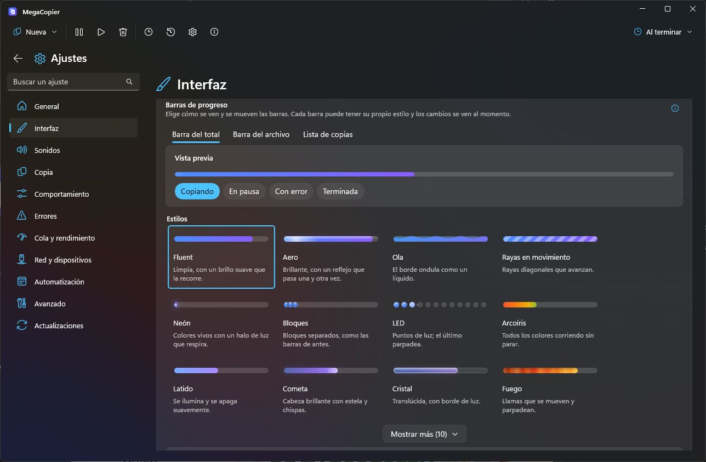

| Estilo | Cómo es |
|---|---|
| Fluent | Limpia, con un brillo suave que la recorre. |
| Aero | Brillante, con un reflejo que pasa una y otra vez. |
| Ola | El borde ondula como un líquido. |
| Rayas en movimiento | Rayas diagonales que avanzan. |
| Neón | Colores vivos con un halo de luz que respira. |
| Bloques | Bloques separados, como las barras de antes. |
| LED | Puntos de luz; el último parpadea. |
| Arcoíris | Todos los colores corriendo sin parar. |
| Latido | Se ilumina y se apaga suavemente. |
| Cometa | Cabeza brillante con estela y chispas. |
| Cristal | Translúcida, con borde de luz. |
| Fuego | Llamas que se mueven y parpadean. |
| Terminal | `[#####·····]` como en la consola, con cursor. |
| Línea fina | Una línea discreta con un marcador que late. |
| Doble capa | Una capa clara va delante y la sólida la sigue. |
| Píxeles | Cuadraditos como en un videojuego, con destellos. |
| Metal | Metal cepillado con un destello. |
| Contorno | Solo el borde y un relleno rayado. |
| Degradado fluido | Sus dos colores se mezclan y fluyen. |
| Burbujas | Burbujas que viajan por dentro. |
| Semáforo | Rojo al empezar, ámbar a la mitad y verde al final. |
| Segmentos | Veinte tramos que se llenan uno a uno. |

Y para cada barra: **colores** (los del tema, los tuyos con muestras listas o el selector, semáforo o arcoíris),
**grosor**, **redondeo**, **velocidad de los efectos**, **brillo y halo**, **porcentaje** (a la derecha, dentro de la barra u
oculto), **cómo avanza** (suave, elástico o a saltos), **efectos según el estado** (rayas ámbar en pausa, sacudida con
error y destello verde al terminar), **borde** y **reducir animaciones**. «Usar este aspecto en las tres barras» lo copia
a todas. Si guardas un tema propio, guarda también sus barras.

Todos los temas y conjuntos en imágenes: [README > Temas](../README.md#temas).

---

## 19. La consola `mcopy`

`mcopy.exe` está en la carpeta de MegaCopier (`%LOCALAPPDATA%\Programs\MegaCopier`). Copia por sí sola, sin la app, o le
entrega la copia a la app con `send` (la arranca si está cerrada).

### Comandos

```text
mcopy copy <origen>... <carpeta-destino> [opciones]      copiar
mcopy move <origen>... <carpeta-destino> [opciones]      mover (instantáneo en el mismo disco)
mcopy send <origen>... <carpeta-destino> [--verify] [--move] [--also <otra-carpeta>]... [--at HH:mm]
                                                         entregar la copia a la app (ventana y bandeja)
mcopy send ... [--mirror|--update-only|--folders-only] [--dry-run]
mcopy send --test <sumas|carpeta>...                     comprobar sumas en la app
mcopy send --hash <carpeta|archivos>...                  crear un archivo de sumas en la app
mcopy send --delete [--secure] <ruta>...                 borrar (de forma segura) desde la app
mcopy test <sumas|carpeta>...                            comprobar sumas sin la app
mcopy decrypt <cifrados|carpeta>... <carpeta-destino>    descifrar archivos .mcenc
mcopy delete [--secure] --yes <ruta>...                  borrar sin la app (--secure: sobrescribe antes)
mcopy repair <carpeta>                                   reparar con los datos de recuperación
mcopy verify-manifest <manifiesto.json>                  comprobar un manifiesto forense
mcopy backup <orígenes>... <repositorio>                 copia de seguridad sin duplicados
mcopy snapshots <repositorio>                            listar las copias de seguridad
mcopy restore <repositorio> [id|latest] <destino>        restaurar una copia de seguridad
mcopy resume [id]                                        continuar los trabajos interrumpidos (o solo uno)
mcopy jobs                                               listar los trabajos pendientes
mcopy status                                             estado de la app
mcopy mcp                                                servidor MCP para asistentes de IA
```

### Opciones de `copy` y `move`

| Opción | Qué hace |
|---|---|
| `--verify` | Relee el destino sin caché, compara las sumas y repara los bloques dañados. |
| `--conflict <modo>` | `overwrite` (por defecto), `skip`, `newer`, `rename`, `fail` o `ask`. |
| `--force` | Copia aunque el destino sea idéntico. |
| `--limit-mb <n>` | Limita la velocidad a n MB/s. |
| `--mirror` | Espejo: quita del destino lo que ya no está en el origen. |
| `--update-only` | Solo actualiza los archivos que ya existen en el destino. |
| `--folders-only` | Solo crea la estructura de carpetas. |
| `--dry-run` | Simula: dice qué haría con cada archivo sin cambiar nada. |
| `--versions <carpeta>` | Guarda lo reemplazado o quitado en esa carpeta del destino. |
| `--keep-versions d,s,m` | Con `--versions`: días, semanas y meses de versiones a guardar (p. ej. `7,4,12`). |
| `--skip-junk` | Omite `Thumbs.db`, `desktop.ini`, `.DS_Store`, `~$…`. |
| `--skip-duplicates` | No copia lo que ya está en el destino (mismo contenido, cualquier nombre). |
| `--organize` | Organiza fotos y vídeos en carpetas año-mes por la fecha de toma. |
| `--atomic` | Todo o nada: la carpeta solo aparece cuando está completa. |
| `--delta` | Al reemplazar archivos grandes, escribe solo los bloques que cambiaron. |
| `--rescue` | Modo rescate para discos dañados. |
| `--recovery <n>` | Guarda datos de recuperación (n % de paridad). |
| `--forensic` | Manifiesto forense firmado. |
| `--encrypt` | Copia cifrada con contraseña (AES-256, `.mcenc`). |
| `--zip` / `--7z` | Copia a un ZIP o a un 7z (con `--encrypt`, cifrado). |
| `--wipe <m>` | `zeros`, `random`, `dod3` o `dod7`: pasadas de `delete --secure`. |
| `--backup` | Modo copia de seguridad: salta los permisos (consola de administrador). |
| `--efsraw` | Copia los archivos cifrados con EFS sin descifrarlos. |
| `--smb-compress` | Pide compresión SMB al copiar por red. |
| `--also-from <carpeta>` | Otro sitio con lo mismo que el origen: los archivos grandes se leen de todos a la vez. |
| `--connections <n>` | Conexiones a la vez con un servidor (1-255, por defecto 4). |
| `--no-shield` | Desactiva el escudo contra ransomware. |
| `--chunk-mb <n>` | Cada cuántos MB se confirma en el disco (por defecto 64). |
| `--block-mb <n>` / `--queue <n>` | Tamaño de cada lectura y escritura, y cuántas a la vez. |
| `--no-unbuffered` | Usa la caché de Windows en vez de E/S directa. |
| `--crash-after-mb <n>` | *(prueba)* Mata el proceso tras confirmar n MB, para probar la reanudación. |

**Ctrl+C** pausa la copia; `mcopy resume` la continúa desde el último bloque confirmado.

### Ejemplos

```text
mcopy copy D:\Fotos E:\Copias --verify
mcopy copy D:\Trabajo \\NAS\Trabajo --mirror --versions .versiones --keep-versions 7,4,12
mcopy copy D:\Proyecto E:\Proyecto.7z --7z --encrypt
mcopy send D:\Vídeos E:\Vídeos --also F:\Vídeos --at 23:30
mcopy backup D:\Documentos F:\CopiasSeguridad
mcopy restore F:\CopiasSeguridad latest D:\Recuperado
mcopy test E:\Copias\sumas.sha256
```

---

## 20. Versión portátil

Descarga `MegaCopier-<versión>-portable.zip`, descomprímelo donde quieras (también en un USB) y ejecuta
`MegaCopier.exe`. El archivo `portable.txt` que lleva dentro hace que guarde **todo en la carpeta `Data`** de al lado: no
escribe en el registro ni en tu perfil.

La versión portátil no sustituye el Ctrl+V del Explorador ni añade opciones al menú contextual (eso necesita el
instalador), pero hace todo lo demás: copiar arrastrando a su ventana, el menú *Nueva*, sincronizar, copias de seguridad,
servidores y la consola `mcopy`.

---

## 21. Cómo funciona por dentro

La reanudación tras un apagón, paso a paso:

1. Nunca se escribe en el nombre final: se copia a `archivo.ext.mcpart`.
2. Por bloques (64 MB por defecto): los datos se vacían al disco (`FlushFileBuffers`) y **solo después** se anota el bloque
   y su suma (XxHash128) en `archivo.ext.mcjournal`.
3. Al reanudar manda el diario, no el tamaño del archivo: se descartan registros rotos (cada uno lleva su CRC32), se
   comprueba que el origen no ha cambiado y se releen del disco los últimos bloques por si el disco «mintió» sobre lo que
   había guardado.
4. Al terminar: fechas y atributos, renombrado atómico al nombre final y borrado del diario.

Tras un apagón se pierde como máximo un bloque.

La app es de **instancia única por usuario**: el primer proceso queda en la bandeja y todo lo demás (la extensión del
Explorador, `mcopy`, otro `MegaCopier.exe`) le entrega la petición por una tubería con nombre propia del usuario. Por eso
pegar con Ctrl+V empieza a copiar en milisegundos. Más detalles técnicos en [Compilar.md](Compilar.md#arquitectura).

---

## 22. Rendimiento

E/S asíncrona sin caché con 4 lecturas y 4 escrituras simultáneas de bloques de 4 MB; la suma se calcula en orden mientras
las escrituras siguen en curso. Medido el 15/10/2026 con 4 GB, contando hasta que los datos están en el disco:

| | MegaCopier | robocopy |
|---|---|---|
| Entre dos NVMe (990 EVO → 990 EVO Plus) | 3.050–3.900 MB/s | 1.800–2.290 MB/s |
| Verificación (relectura sin caché + suma) | ~6.800 MB/s | — |
| Mismo NVMe | 460–1.140 MB/s | 460–900 MB/s |

En el mismo disco manda el SSD: tras agotar su caché SLC baja a unos 500 MB/s con cualquier programa.

| Arranque | Tiempo |
|---|---|
| App en la bandeja: Ctrl+V → copia en marcha | 4–33 ms |
| App en la bandeja: Ctrl+V → ventana visible | 32–112 ms |
| App cerrada: petición → app abierta y ventana visible | 279–477 ms |

---

## 23. Limitaciones conocidas

- Algunas funciones están programadas y probadas con pruebas automáticas, pero no se han podido probar todavía en un equipo
  real (ReFS, VSS, nubes, móviles por USB, modo copia de seguridad, EFS…): la lista está en la
  [comparativa](Comparativa-copiadores.md#1-lo-que-está-hecho-pero-no-se-ha-podido-probar-en-real). Si algo falla, avisa o
  copia de la forma normal; nunca se pierde la copia por ellas.
- No se ha probado todavía un **apagón real** (sí procesos matados y fallos simulados en cada punto crítico).
- Las nubes piden **registrar la app** en cada servicio una vez ([cómo](Nube.md)): la versión publicada no lleva
  identificadores propios.
- Cambiar el **idioma** requiere reiniciar MegaCopier.
- Los errores de los archivos se muestran traducidos; el detalle técnico y el registro interno del motor están en español.
- En discos **SSD**, el borrado seguro no garantiza borrar las copias internas del disco (para eso, BitLocker).
- Crear **enlaces simbólicos** de archivo en el destino requiere el modo de desarrollador o permisos de administrador; las
  carpetas enlazadas se recrean como uniones, que no lo requieren.
- Algunos archivos solo se leen con **permisos de administrador** (los `.exe` de los juegos de Xbox y de la Microsoft
  Store, carpetas de otros usuarios): ni la copia de Windows puede leerlos sin ellos. MegaCopier copia el resto y al
  final pide permiso una vez (*Ajustes > Errores*), como el Explorador. Si Windows protege el archivo incluso para los
  administradores, queda marcado con su error.
- El instalador **no está firmado**: Windows muestra el aviso de SmartScreen hasta que se firme.
- Solo para **Windows 11 de 64 bits**.

¿Algo no funciona? Mira las [preguntas frecuentes](Preguntas-frecuentes.md) o
[abre una incidencia](https://github.com/cbatista96/MegaCopier/issues/new/choose).

En Actualizaciones, el botón ofrece **Buscar actualizaciones** al entrar. Solo muestra **Estás al día** después de una búsqueda manual sin versiones nuevas y vuelve a ofrecer la búsqueda al salir y regresar. Si hay una versión pendiente, ofrece descargarla o instalarla según su estado. Las principales novedades de la versión actual o los cambios de la disponible aparecen antes del historial. Las opciones de red se colocan en horizontal con separación.

Los botones laterales Atrás/Adelante del ratón y **Alt+Izquierda/Derecha** navegan por las pantallas visitadas, incluidas las secciones de Ajustes y el historial de versiones. Una ruta nueva descarta la rama de avance; los diálogos abiertos no se cierran ni se saltan con estos botones.

El botón Ajustes de la barra superior actúa también como regreso: al pulsarlo desde cualquier sección de Ajustes, vuelve a la copia o a la pantalla de inicio y recupera el tamaño anterior de la ventana, incluida la vista pequeña. La ayuda «Volver» solo aparece sobre su botón, no por pasar el ratón por la ventana.

Entrar en Actualizaciones conserva el último resultado correcto, aunque no haya Internet: «MegaCopier está al día» o la versión disponible con sus novedades guardadas. Solo una búsqueda o descarga manual sin conexión muestra el aviso de red y la X roja; al salir de la sección y regresar, vuelve el último resultado guardado. El botón ofrece buscar, descargar o instalar según corresponda. Una reconexión permite completar descargas pendientes y una comprobación automática vencida, respetando los permisos y opciones. El aviso de ZIP portátil solo aparece si existe una versión nueva. Los resúmenes explican cada mejora con una o dos frases cuando hace falta; pueden incluir más de diez puntos en versiones grandes y agrupan los arreglos menores según la guía de publicación.


## Compatibilidad y permisos de copia

Se han probado copias y sobrescrituras con verificación de contenido en NTFS, exFAT y FAT32. FAT32 conserva su límite de tamaño por archivo; ReFS no se ha probado en el equipo de desarrollo. La copia a exFAT utiliza una alternativa compatible cuando el sistema de archivos no admite el renombrado avanzado.

Si una copia necesita autorización, muestra «Necesita permisos de administrador». Con la recuperación automática activada, Windows solicita autorización cuando hace falta; el proceso autorizado también intenta recuperar los archivos en uso desde una instantánea, sin encadenar otro intento sin permisos. Los bloqueos que no se puedan recuperar se conservan como fallos reales.

El historial de actualizaciones muestra diez versiones por bloque. «Mostrar más» carga las diez siguientes.
